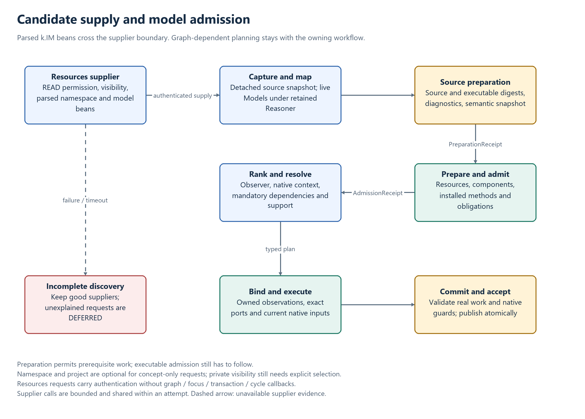

# Model and observation admission

Admission establishes whether a candidate, request, scope or execution may cross a particular
boundary. Access, parsed-source validity, semantic compatibility, installed implementation,
native ownership and scientific completion are separate checks. Passing one does not imply
the others.

Read [Observations](OBSERVATION.md) for meanings and activities, [Resolution](RESOLUTION.md)
for planning/execution, and [Consequence admission](CONSEQUENCE_ENGINE_ADMISSION_AUDIT.md)
for post-commit operations.

## Admission through the lifecycle

[Editable diagram](diagrams/model-admission.drawio).

| Gate | Required evidence | Result |
| --- | --- | --- |
| Source visibility | Authenticated user/federation, supplier READ permission and lexical visibility | Candidate beans may be supplied |
| Source preparation | Active parsed namespace, no blocking diagnostics, stable source/model digest and retained semantic actor | Controlled prerequisite preparation is allowed |
| Implementation admission | Prepared resources/components, installed methods and checked model obligations | Candidate may participate in executable planning |
| Context and dependency resolution | Correct native bearer/observer, required context and relevant mandatory-input coverage | A typed contextual plan can be constructed |
| Runtime binding | Exact owned target, compiled ports, current inputs, source/semantic proofs and supported plan | Executable work may be staged |
| Publication | Successful required work, native read guards, lifecycle, cancellation and atomic-root checks | Accepted changes become durable |
| Scientific acceptance | Operation-specific completion/reuse evidence and required support | The result may justify the requested conclusion |

Neither a planned RESOLVED outcome nor a positive observation ID alone proves scientific
completion. An individual can exist through acknowledgment without a numerical computation.
An error-free NO_MODEL decision is acceptable only under the corresponding lifecycle policy.
Unknown discovery, partial support and failed execution cannot justify an exhaustive empty result.

## The model path

1. **Discover visible candidates.** Resources returns parsed k.IM language beans with their
   retained source, provider identity and immutable namespace snapshot. The owning Resolver
   constructs live Model objects using its retained Reasoner. Private models require the
   matching ResolutionNamespace; project-private models require ResolutionProject. A concept-
   only request can use public models without either selector.
2. **Prove source preparation.** `ModelValidationGate.validatedSourcePreparation` checks the
   captured active namespace, parser diagnostics, source timestamp/digest, executable digest
   and semantic snapshot. Matching publication evidence may be reused; otherwise validation
   uses the owning retained actor. The PreparationReceipt does not authorize execution.
3. **Prepare prerequisites.** Runtime resolves components, resources and contextualizers in
   the model's lexical namespace/project. Missing requirements or error diagnostics reject
   the candidate. Preparation caching includes the model and its scope witness.
4. **Admit the installed implementation.** `validatedPreparableAdmission` checks installed
   methods and retained semantic obligations. Preparation and AdmissionReceipt must describe
   the same source/production snapshot. Compatibility and admission precede ranking.
5. **Resolve dependencies.** Mandatory dependencies require relevant coverage. Entering another
   model-native context can require preparation/admission there. Deferred classifier/member-
   quality obligations must be discharged by their supported execution continuations.
   The accepted graph retains the original producer AdmissionReceipt for compilation.
   Compilation, including observer-contribution metadata, consumes that receipt without
   repeating document validation or replacing it with a later source/semantic publication.
   Model identity, namespace, executable digest and the full retained semantic binding must
   still match the graph. Missing or changed evidence rejects compilation; it does not cause
   a fresh admission to overwrite the planned proof.
6. **Recheck and execute.** Runtime verifies the producing-model proof and the actual bound
   inputs, executes the required work, and validates the root attempt before publication.

PREPARABLE discovery intentionally includes candidates whose prerequisites can be prepared.
It is not an installed-method or execution certificate. Source or semantic changes invalidate
applicable reuse in subsequent attempts. An already admitted attempt retains its captured
source and semantic view. Changing its executable model, proof or scope witness is not
authorized by that snapshot; Runtime still checks the actual bindings before execution.

## Receipts and semantic cycles

A ContextScope commits to one Runtime and one Resolver. “Local” identifies their owning
workflow, not a hostname. Both need knowledge-graph access. Resources can reconstruct the
requester but is not assumed able to query a non-public originating service.

Resources supplies parsed `KimNamespace`, `KimModel` and observable beans, including source
retained by their contract. It is a provider of potential candidates, not a graph-dependent
participant in this resolution workflow. Candidate/source reads carry authentication and
optional lexical selectors without focus, transaction, consequence or cycle callbacks.

`modelCandidateProtocol=1` selects candidate export; protocol 0 uses authenticated namespace
listing. The owning Resolver captures the response, maps it with its retained Reasoner and
checks local eligibility. Provider publication/index status does not substitute for local
admission. Explicit inactivity and blocking parser diagnostics remain relevant.

One detached response per provider/lexical selection is shared within an attempt, including
concurrent dependency queries. Mapping templates are detached again before consumer-specific
preparation. Neither cache is a global model grant, durable catalog lease or crash-replay
protocol. Broad authorized candidate export avoids filtering with a supplier's different
semantic actor; local filtering/ranking selects the applicable meanings.

Supplier failure/timeout leaves discovery incomplete while retaining successful suppliers.
An executable explanation can proceed with that diagnostic. If no explanation is available,
incomplete discovery yields DEFERRED, including for optional requests; it cannot prove NO_MODEL.
An available empty catalog and an unavailable catalog have different meanings.

| Evidence | Establishes | Does not establish |
| --- | --- | --- |
| Namespace validation | Parsed/source semantics against a particular actor | Installed implementation, contextual suitability or execution |
| PreparationReceipt | Source/model snapshot for prerequisite preparation | Execution authority |
| AdmissionReceipt | Executable validation and retained obligations | Completed dependencies, pending proofs or output values |
| Resolution-cycle binding | Owning Runtime/context/cycle and retained semantic actor | Ownership of an arbitrary supplied observation |
| Semantic dependency witness | Checked semantic obligations and relevant authority evidence | Native membership, source execution or stored scientific values |
| Native execution/selection receipt | The exact guarded operation/view under its supported contract | Transferable authority in a serialized copy |

`matches` rechecks receipt applicability; `sameSnapshot` compares preparation and executable
contracts. The cycle-bound Reasoner facade uses the retained actor for capabilities and
semantic operations. A missing retained actor fails explicitly rather than falling back to
current semantics. A semantic receipt is not an authentication credential, and a retained
logical actor does not freeze an external mutable authority dataset.

The observer is fixed through the cycle and its consequences. A later explicit request in
the same twin waits for causal work to drain; causal children retain the parent's cycle and
must not wait behind it. Independent twins are not serialized by this rule.

## Planning ownership and operative lifecycle are different

| State | Identity/authority | Permitted use |
| --- | --- | --- |
| Unassigned (`-1`) or query sentinel (`0`) | No owned observation identity | Cannot become an admitted observation focus |
| Registered planning candidate (below `-1`) | Active root transaction's provisional registry | Planning and admission in that owned attempt |
| Staged birth | Canonical transaction-graph object | Native lifecycle checks recognize the owning new asset |
| Committed observation | Durable graph | Use while authoritative lifecycle and operation-specific completion are current |
| Failed or closed candidate | No active provisional authority | Cannot be restored as a planning focus |

`RuntimeService.register` allocates a provisional identity without staging a graph vertex.
Rejected candidates therefore leave no durable observation behind. The registry is root-shared
and is released when that root completes. Staged canonical assets take precedence once present.

`getObservationForAdmission` can retrieve a registered candidate from its active non-failed
owner. `getObservation` retains operative currentness checks. Planning registration alone
does not create a staged birth, make `isObservationCurrent` true, or authorize scheduling.

Child transactions share graph/commit state and original read guards with their root. They
have distinct execution scopes. Checks requiring the active child must receive that scope;
the storage scope inherited from a parent is not a substitute.

## Selected query inputs

An ordinary model can consume a concrete-predicate collective through a named dependency.
Runtime completes the deferred selection within the consumer's root attempt and binds the
original issued view to that exact compiled port. `SelectedQueryInput` binds transaction,
consumer, cohort, plan and local alias by server-held identity.

Capture/storage reject a missing or changed receipt, copied view, wrong cohort, changed alias,
different consumer, parent/sibling transaction and failed owner. Storage validates the actual
compiler execution scope. Increasing the enclosing scope observation's child count during
consumer staging does not change its semantic identity; the selected view's own count and
full checked payload remain bound.

Retained/transported input references undergo read-only revalidation before execution. Committed
consumers retain JSON alias-to-selection metadata for inspection. Serialization is an audit/read
contract and cannot recreate the private issuance capability. Consumer failure rolls back newly
staged discovery, classification and outputs with the uncommitted attempt.

For partial discovery, completed native fragments and newly executing producers remain separate
contributions. After prerequisites finish, native fragment references receive fresh issued
queries before sealing. This preserves completion checks when the successful contributor set
changes. See [Collective completion](COLLECTIVE_COMPLETION.md).

## Restoring a scope across HTTP

The receiver authenticates the user and resolves the context before restoring cycle, transaction,
observation path, observer and focus. Provisional focuses do not appear as durable path elements.
The Runtime planning lookup is `GET /api/v1/asset/{id}/admission`, under its service context path.

Runtime requires an active registered non-failed transaction, its server-held execution scope,
matching authenticated user/context/observer/cycle, and an identity actually retrievable under
that owner's admission scope. The detached response, request headers and numeric ID do not
create ownership. Missing ownership fails rather than using a client cache.

Ordinary `GET /api/v1/asset/{id}` reads retain lifecycle validation and are used for currentness
checks. Planning admission cannot certify current execution. Service authentication, even for
local/anonymous operation, establishes an identity but does not waive these ownership checks.

Runtime, Resolver and retained semantic operations must deploy compatible scope/receipt contracts.
Supplier-only Resources requests use their separate source-export contract and need no callback
to the planning lookup. See [Resources candidate supply](RESOURCES.md#candidate-source-supply).

## Publication and consequence acceptance

Before a root commit, validate the actual native read sets, source/semantic proofs, target and
input identity, current lifecycle, required support and cancellation. Do not replace a full native
capture with its audit projection. Child completion and allocated identities are not publication.

Consequences start after a successful root commit and retain the admitted cycle and observer.
Their source relevance, ownership and scientific completion must be checked independently.
For CHANGE, require applicable RESOLVED evidence or separately loaded complete native reuse
evidence, correct bearer/observer and complete required support before APPLIED. Optional typed
NO_MODEL is nonfatal; unknown or partial completion remains deferred. Duplicate metadata cannot
waive recomputation, source, cycle or native-input guards.

## Scheduled event acceptance

The [`@resolution` instantiation policy](INSTANTIATION_RESOLUTION.md) changes secondary
explanatory selection, not native acceptance. `none` acknowledges existence without numerical
proof; `collective` retains one frozen selection and admission snapshot while independently
binding and checking every child's support and inputs. An originating observation policy
overrides producer declarations. All modes retain ordinary transaction ownership and atomic
publication of the produced batch.

An event instantiator's schedule/plan admission and an individual event's start/end execution
are separate gates. Instantiators execute on accepted temporal intervals, never as temporal
work under INIT. Validate the full produced batch and complete required individual resolution
before publishing it. Individual periods must be bounded, positive and atomic, with starts
consistent with the logical instantiation time.

Preparing an individual plan does not prove START/END execution. Each boundary uses current
owned inputs and a fresh transaction, and publishes actual effects with its completion flag.
Check start/end values, pending visibility, rollback/retry and durable history independently
of successful instantiator registration. Complete dedicated event acceptance remains unverified;
see [event checks](OCCURRENCE.md#event-acceptance-requirements).

## Acceptance checks

Verification must exercise the same boundary as the claim being made:

| Claim | Required check |
| --- | --- |
| Language accepted | Real parser, adapter and populated interface transport |
| Candidate visible | Supplier authorization/lexical rules, including absent namespace/project selectors |
| Candidate admitted | Captured source, retained actor, preparation/install checks, context and negative controls |
| Plan correct | Dependency order, actual ports, relevant coverage and supported deferred obligations |
| Consumer executable | Distinct root/child scopes, original issued input, actual contextualizer invocation and value assertion |
| Work atomic | Genuine failure after earlier effects; unchanged native observations, attributions, storage and history after rollback |
| Result inspectable | Committed provenance/selection metadata through public retrieval and inspector APIs |
| Reuse/recovery valid | Persisted activities and full native captures, restored semantic inputs and supported replay/recovery contract |
| Live workflow valid | Matching deployed services, public submission APIs, completed activities and scientific outputs |

A non-null response (`inspector.present`) is insufficient to establish success. Negative cases
check the failure response, verify the intended consumer/producer actually ran, and compare native
state. Numeric assertions should distinguish execution from default-initialized storage.
Fixtures checking committed inspection must retain historical provenance; fixtures checking native
members must make all read paths describe the same catalog. Parser or helper success alone does
not establish scientific execution, complete service integration or production-wide performance.

## Implementation map

- `ModelValidationGate`, `SourceModelMapper`, `ModelCandidateSources`: captured source and executable admission.
- `ResolutionCompiler.prepareCandidate`, `PrioritizerImpl`: scoped preparation, eligibility and ordering.
- `ServiceContextScope`, `ScopeManager`, `RuntimeService`: identity, scope restoration and submission.
- `CompiledDataflow`, `SelectedQueryInput`: actual compiled target/input association and execution binding.
- `CollectiveSelectionContinuation`, `CollectiveSelectionExecution`, `SemanticExecutionEvidence`: deferred views and semantic/native evidence.
- `DigitalTwinImpl.TransactionImpl`, `KnowledgeGraphNeo4j`: provisional ownership, full read guards and atomic publication.
- `ResolutionCycles`, scheduler and consequence handlers: cycle lifetime, causal scheduling and post-commit acceptance.
