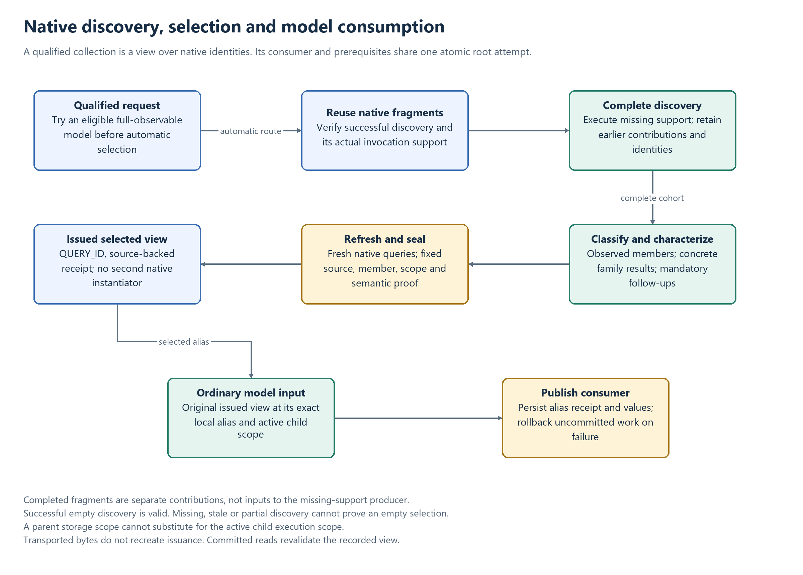

# Collective completion and selected inputs

A collective query must distinguish completed discovery from a plan, a registered producer
and an unknown collection. Successful zero-member discovery is positive evidence of an empty
collection; an empty failure sentinel is not. See [Observation semantics](OBSERVATION.md),
[Resolution](RESOLUTION.md) and [Admission](ADMISSION.md).

## Completion evidence

CONTRIBUTED_TO is recorded during registration/compilation. It does not prove execution.
Completed discovery requires:

- A successful typed activity for the actual producer: INSTANTIATION/INSTANTIATED or
  CONNECTION/CONNECTED, including the required individual lifecycle work.
- The invocation's actual `im:execution-geometry`, clipped to producer support, rather than
  an assumption that the registered extent was executed.
- A current native lifecycle, matching observer/context and applicable semantic/source evidence.
- For staged work, a non-failed owning attempt. Later sibling/root failure invalidates that
  uncommitted success. Durable reuse reads actual committed activities and effects.

Positive IDs, commit metadata, resolved fractions and registered geometry do not independently
establish these facts. Existing observations without sufficient completion evidence require
normal revalidation/resolution; inspection does not manufacture a receipt.

## Support and multiple contributors

Invocation, producer and request must have compatible dimension types. Intersections do not
broadcast a missing spatial or temporal dimension. Query coverage describes discovery support,
not member-footprint union or environmental-field coverage.

The query first chooses a proven successful fragment. It can certify a complete multi-source
cover through the supported slab proof: spatial pieces must cover the requested shape while
fully covering its other dimensions, or contiguous temporal intervals must cover the requested
period while fully covering the other dimensions. Diagonal space-time fragments cannot be
replaced with their Cartesian hull. Gaps, unsupported geometry and failed difference operations
do not establish completeness; retain an actual proven fragment instead.

The result's source IDs identify the actual selected contributor(s). A single-fragment view
retains its producer's reported children count; a composed native view enumerates membership.
Scientific reductions and qualified selections independently use their guarded member set.
An arbitrary native view's `childrenCount` is not a general clipped COUNT implementation.

## Completing partial discovery

Reuse completed support and resolve the representable missing part. If exclusion cannot
represent a remainder, use a conservatively sufficient domain. Keep the completed fragments
as separate native contributions; do not attach their query views as inputs to the producer
executing the remaining discovery.

After discovery/classification work, refresh native reference roots with newly issued completed
queries before sealing the selection. Contributor choice can change when another valid producer
arrives. A transported pre-completion view cannot certify that new state by itself. Preserve
earlier member/source identities and validate the original native read sets through commit.

[Editable diagram](diagrams/collective-selection.drawio).

## Concrete selection

The positive concrete-predicate Subject/Agent route retains an explicit native focus and the
request's support. It first allows an eligible complete-observable model. The automatic route
then completes bare native discovery, establishes required predicate families on those same
members, and filters a virtual view. Existing valid classifications need no reinvocation.
Attribution preserves identity, geometry and native cohort; new predicates require normal
individual characterization.

The view has QUERY_ID and a versioned `CollectiveSelectionView` receipt. Source, cohort and
member identities, predicate/family meanings, geometry, context, observer and scoped semantic
evidence remain bound. The view does not create another qualified instantiator or a persistent
observation. Unknown discovery or a failed classifier cannot be returned as an empty selection.

## Consumption by an ordinary model

The Resolver retains a selected dependency's deferred plan and local alias. Runtime completes
it in the consumer's root attempt and attaches its original issued view to the exact compiled
port. `SelectedQueryInput` is a server-held capability bound to the transaction, cohort,
consumer and plan; it is not reconstructed from receipt bytes.

Capture/storage reject changed payloads, aliases, consumers or cohorts, foreign/parent/sibling
transactions, failed owners and copied issuance. Storage receives the compiler's active child
execution scope even though transaction storage state is root-shared. The enclosing focus's
child counter can change during staging without changing its semantic identity; the selected
view's own payload and count remain exact.

Execution revalidates retained/transported references read-only. A committed consumer stores
JSON alias-to-selection metadata for inspection. Its numerical output must be verified separately
from that receipt. Consumer failure rolls back newly staged discovery, attribution and outputs.
See [selected-input admission](ADMISSION.md#selected-query-inputs).

## Scoped semantic evidence and reuse

Selection receipts compose actual execution signatures with a `semantic-dependency-v1` witness
under `semantic-content-v2`. Accepted source/strategy/compiler configuration and relevant
authority evidence participate in semantic identity. Process-local generations and actor sessions
remain active execution fences; equal counters alone prove neither unchanged semantics nor reuse.

Durable revalidation reconstructs canonical semantic inputs with the accepted compiler and checks
their dependency closure. Authority access uses captured responses or configured snapshots where
required. Missing mutable answers and unknown execution footprints cannot be treated as semantic
independence. A retained actor does not freeze an external mutable authority dataset.

An authority-independent complete signature can remain valid despite unrelated mutable providers.
A relevant deterministic snapshot contributes its immutable digest. Changed relevant semantics,
source, strategy or authority content requires revalidation. Legacy receipts are not relabeled or
certified merely because their observations still exist. Provider refresh/retraction and a general
external authority snapshot protocol are separate contracts.

## Verification

Compare discovery/replay with identical context, observer and support. An independent unqualified
substantial resets focus; a qualified selection preserves its explicit focus. Their receipts are
not interchangeable when those contexts differ.

Partial-completion checks retain earlier native identities. Selected-input checks retrieve the
committed consumer's persisted receipt through the public inspector and compare numerical output
with the captured membership. Failure checks establish that the intended producer/consumer ran,
then verify native state and immutable history after rollback. Distinct root and child execution
scopes and real persisted activities are essential when testing those boundaries.

`CollectiveCompletionQueryTest`, `CollectiveSelectionExecutionTest`,
`CollectiveSelectionPlanningTest`, `CollectiveSelectionAtomicExecutionTest`,
`CollectiveSelectionContinuationTest` and `CollectiveSelectionSubmissionScopeTest` cover these
boundaries with controlled collaborators or embedded production graph/storage as appropriate.
General scientific sampling, arbitrary member/region redistribution and unspecialized graph
composition remain outside this contract.
