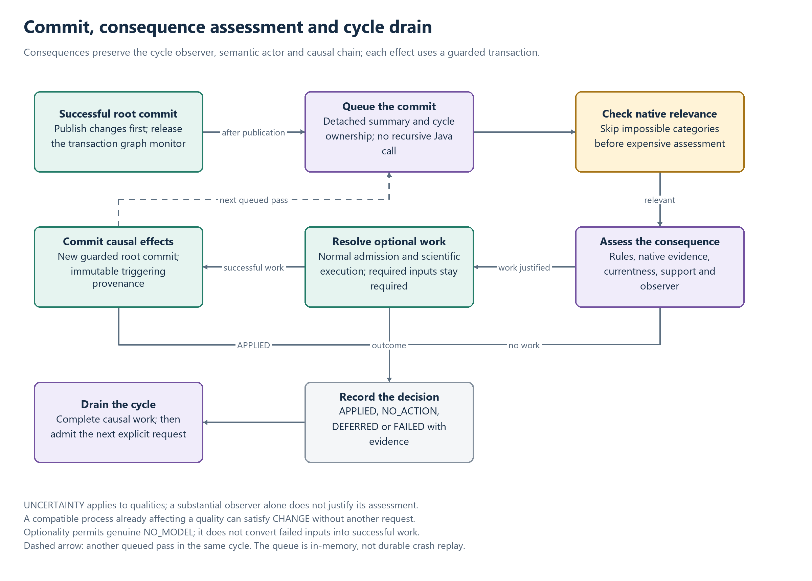

# Consequence admission and acceptance checks

This reference describes the guards required when committed observations cause additional
resolution work. It complements [Admission](ADMISSION.md),
[Consequence contracts](CONSEQUENCE_ENGINE.md) and
[Capabilities and limits](CONSEQUENCE_ENGINE_STATUS.md).

## Assessment, execution and publication

[Editable diagram](diagrams/consequence-cycle.drawio).

The engine receives successful root commits, derives a cause-preserving scope and first checks
native relevance. Only applicable categories enter semantic assessment. Justified requests use
normal model/source/implementation admission, current native inputs and scientific execution.
A successful resulting root commit is a new causal commit; failure does not undo its trigger.

## Required guards

| Boundary | Required behavior | Reject or defer |
| --- | --- | --- |
| Relevance | Skip categories only with affirmative native evidence of irrelevance | Unknown changes must not be silently discarded |
| CHANGE | Identify actual qualities and their native bearer; recognize a compatible current semantic process writer with complete support | Descriptive/wrong-bearer/wrong-observer/partial influence is insufficient |
| Scientific completion | Require applicable RESOLVED work or independently loaded complete native reuse evidence and operation-specific support | IDs, empty plans, duplicate metadata or partial results do not justify APPLIED |
| Allocation/publication | Allocate identities and encode receipts through the actual native transaction | A helper-returned provisional object is not a committed observation |
| Recompute | Retain original input captures, source/semantic/model proof and same configuration identity under guarded execution | Receipt restoration cannot bypass currentness, concurrency or scientific-input validation |
| Nested work | Inherit cycle/cause, ownership and cancellation; keep causal children inside the parent's cycle | A child must not queue behind the cycle it is helping to finish |
| Cleanup | Hold ownership until actual work and queued consequences drain; dispose storage only after the worker stops | Subscriber cancellation cannot release shared work prematurely |

UNCERTAINTY concerns qualities. A new substantial observer alone does not justify assessing it.
CHANGE can skip a proven new-substantial-only trigger, while unknown evidence retains the
conservative path. Read-only prefilters must not allocate a write transaction or materialize
unsupported actuator/data assets as observations.

All consequence requests are optional at the top level. Genuine typed NO_MODEL can be nonfatal;
unavailable catalogs cannot prove absence, and mandatory model inputs remain mandatory.
Unknown or partial completion remains DEFERRED. Actual failures are FAILED and do not prevent
assessment of unrelated applicable work.

## Native and semantic evidence

The retained semantic cycle fixes the observer and logical actor through recursively generated
work. Source/receipt applicability is checked under that actor, without substituting current
semantics if the actor is unavailable. Resources supplies parsed candidates through its
authenticated supplier boundary and is not required to query the originating graph.

Native captures retain complete original metadata, structure, membership and absence evidence.
Audit references summarize those captures for storage/explanation; they cannot reconstruct or
authorize a missing capture. Recompute validation checks the full originals immediately before
publication. A superseded capture produces DEFERRED while preserving the guard.

## Acceptance checks

1. Use authenticated public submissions and admitted models with the actual requested context,
   observer and support. A concept-only request must work without namespace/project selectors.
2. Verify that the intended classifier, consumer, process or explanatory method actually executes.
   Check values/effects and completion evidence separately from observation existence.
3. Inject a genuine failure after earlier staged effects; require rollback of uncommitted native
   births, attributions, outputs and revision changes. Preserve independent committed history.
4. Recompute from a changed guarded input and retain the configuration's identity, current modeled
   time, scientific provenance and immutable earlier content.
5. Reject stale/foreign/copied authority, wrong scope/observer/bearer, changed native input and
   unsupported receipt restoration. Duplicate notification must not create equivalent work.
6. Check recursive drain and the next explicit request. A handler awaits its own submissions,
   never the queue that must wait for that handler.
7. Verify committed client lookup and quiet consequence notifications. A background commit is
   not a new user submission and must not steal focus or replace the selected observer.

Parser/transport checks, controlled native execution and live service acceptance exercise different
boundaries. Preserve that distinction when reporting results. Applicable regression families include
`ConsequenceEngineTest`, `ChangeProcessHandlerTest`, `ConsequenceSubmissionTest`,
`PreparedConfigurationRecomputeTest`, `ConsequenceDiscoverySnapshotTest`,
`ConsequenceTransportTest` and the collective/selected-input native execution tests.

## Explicit limits

Durable queue/outbox replay, remote cessation-intent transport, arbitrary multi-root configuration
explanation, mixed-bearer or negative/absence emergence, configuration termination and optional
uncertainty policy require their own supported contracts. No audit receipt, empty result or
unimplemented grammar hook supplies those semantics. See the
[capability boundaries](CONSEQUENCE_ENGINE_STATUS.md#capability-boundaries).
