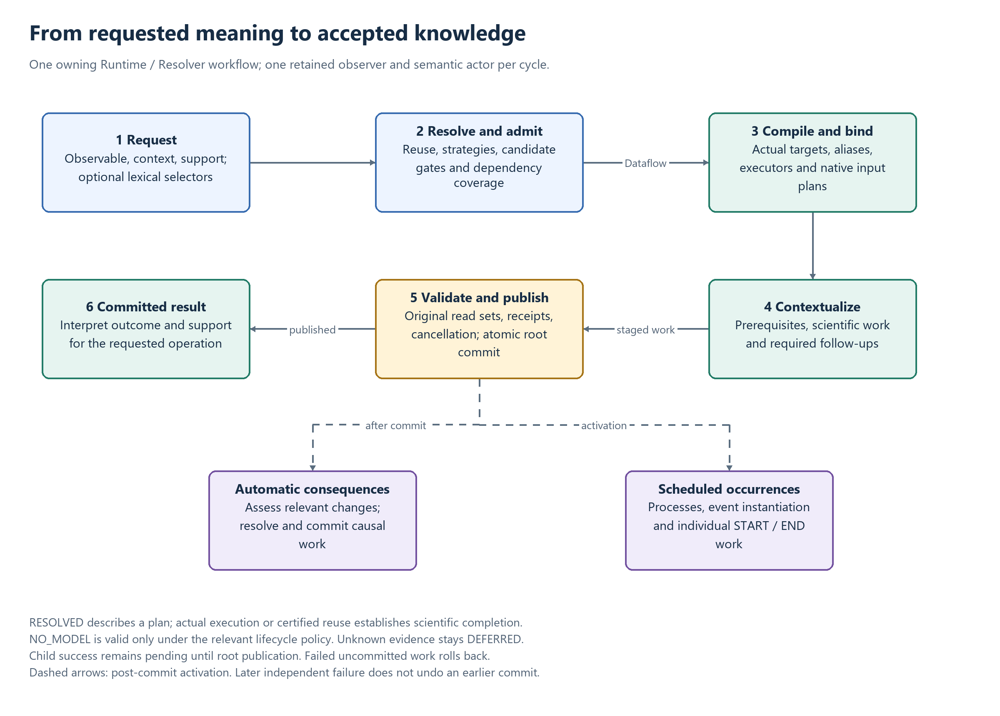
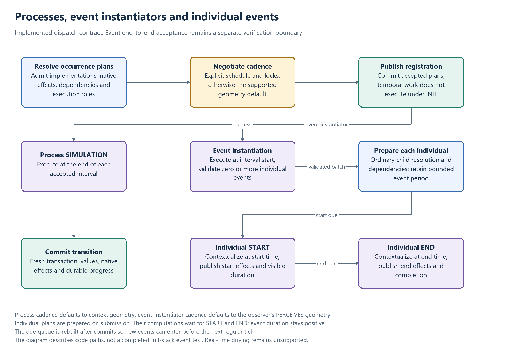
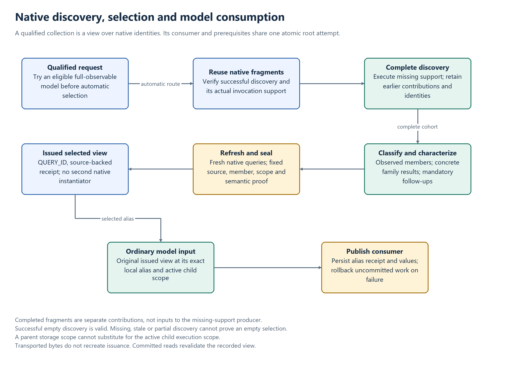

# Observations, strategies and contextualization

An **observable** states a meaning to be observed. A **model** supplies a method. An
**observation** realizes that meaning in a digital twin, with identity, context, support,
provenance and, where applicable, values. An unresolved observation is a request, not evidence
that the requested phenomenon or values have been observed.

This guide describes observation semantics and the executable strategy language. Read
[Resolution](RESOLUTION.md) for planning and execution, [Admission](ADMISSION.md) for the
checks at each boundary, and [Observable expressions](OBSERVABLES.md) for semantic syntax.

## From request to committed observation



[Editable diagram](diagrams/observation-lifecycle.drawio).

Resolution selects an explanation and constructs a contextual Dataflow. Runtime binds that
plan to actual observations and implementations, executes the required contextualizations,
validates the pending changes and publishes a root commit. A resolution activity or successful
child activity can precede publication; neither makes pending work durable.

Acceptance depends on the requested operation. An acknowledged individual may exist without
an explanatory model. A computed quality requires successful execution or certified current
reuse over the required support. A collective requires completed discovery, including the
legitimate zero-member case. A selected collective is a certified virtual view over native
members, rather than a second instantiator. A process records its existence at initialization
and executes SIMULATION on its schedule. Event instantiators likewise execute on an accepted
cadence; their individual events have separate start/end contextualizations.

Automatic consequences follow successful commits. They use new guarded transactions and can
produce further commits. Failure of a later consequence does not undo the triggering commit.
See [Consequence engine](CONSEQUENCE_ENGINE.md).

## Context and semantic lifecycle

The requesting scope supplies the context observation, geometry, time, observer, constraints
and owning Runtime/Resolver. An explicit concept-URN request is sufficient: a namespace and
project are optional lexical selectors, not prerequisites for resolution.

The observer is a resolver-context dimension. Its selected identity remains fixed during a
resolution/contextualization cycle and its consequences. Observer selection and an explicit
`observed as` clause have different meanings; see the
[observer contract](RESOLUTION.md#observer-aware-resolution-contract).

The observable determines the activity; strategies choose explanations within that activity.

| Meaning | Contextualization and required follow-up |
| --- | --- |
| Individual substantial | ACKNOWLEDGEMENT; an error-free explicit NO_MODEL decision can acknowledge existence without inventing computation |
| `each S`, for countable substantial S | INSTANTIATION; acknowledge and resolve the produced individuals |
| Collective event | Scheduled instantiation at interval start; prepare produced individuals, then contextualize them at START and END |
| Collective relationship | CONNECTION; validate endpoints, then acknowledge the produced relationships |
| Physical, numeric, monetary, categorical or Boolean quality | MEASURE, QUANTIFICATION, VALUATION, CATEGORIZATION or VERIFICATION, as selected by the effective semantics |
| `P of each S`, for predicate P and substantial S | CLASSIFICATION of observed members; characterize newly attributed predicates |
| `P of S` | CHARACTERIZATION of an individual substantial, independently of predicate abstraction |
| Predicate of a quality | TRANSFORMATION of that quality |
| Process | Initialize existence and occurrence registration; execute SIMULATION at scheduled transitions |
| Configuration | DETECTION from supported emergence evidence; a model may explain the detected observation |

Classification and characterization are updates to existing observations. Their directives
do not acquire observation IDs, storage or independent scheduling entries. They travel as
typed UPDATE actuators in the same Dataflow contract used for other contextualizations.
See [Classification and characterization](CLASSIFICATION.md).

Models do not instantiate configurations. `model Configuration` can explain an emerged
configuration; `model each Configuration` is invalid. Placement and multi-bearer limitations
are described in the [configuration lifecycle](CONSEQUENCE_ENGINE.md#configuration-lifecycle).


## Geometry and Scale contract

`Geometry` is the portable description of an observation's domain: its dimensions, shape,
location and other geometric parameters. It can also describe the domain accepted or produced
by a resource or computation. It carries no observable semantics, and declarations may leave
dimensions or location unspecified. A geometry does not by itself prove that data exist or that
an observation has been resolved.

`Scale` extends `Geometry` with the runtime topology used for contextualization. It exposes
operational extents such as `Space` and `Time`, their locators, and topology operations. Promoting
a geometry with `Scale.create(geometry, scope)` requires the configured runtime implementation;
it interprets the declaration rather than simply casting the portable object. Current concrete
extent support must not be confused with a general implementation of every possible worldview
topology. `Coverage` adds resolution coverage information; it is not another spelling of Geometry.

### Scalar, universal and empty

These dimensionless values have different meanings and must remain distinct at every boundary:

| Encoding | Meaning | Empty? |
|---|---|---|
| `1` | **SCALAR**: one value without spatial or temporal subdivision. | No |
| `*` | **UNIVERSAL**: an unrestricted domain, without a concrete spatial or temporal extent. | No |
| `X` | **EMPTY**: no domain. | Yes |

Universal is neither a scalar value nor an empty geometry. It does not encode a world polygon,
a grid resolution, or an infinite collection of cells. An absence of dimensions therefore does
not imply emptiness. Cardinality alone must not be used to distinguish these cases; use the
geometry predicates and, for concrete extents, their topology. In particular, a valid default
observer must not be rejected merely because its initial geometry is universal.

### Conversion, transport and persistence

Geometry encodings must preserve their meaning through parsing, promotion to Scale, transport,
and storage. A universal Scale must encode as `*`, a dimensionless scalar Scale as `1`, and an
empty Scale as `X`. Structured geometries must retain the dimension parameters needed to
reconstruct their domain. Converting a universal Scale to an empty string loses this contract.

Use `Geometry.forTransport(...)` for portable observation payloads and `GeometryRepository` for
runtime geometry/scale mediation. Runtime Scale and Coverage implementation details must not
leak into a service payload in place of the portable Geometry representation. The knowledge
graph persists geometry definitions and reconstructs their runtime topology when needed.
Geometry round trips preserve the domain; they do not establish semantic identity, resolution
success, or data availability.

### Occupied and perceived geometry

An observation's ordinary geometry describes what it **occupies** (`OCCUPIES`). An agent can
also have a distinct **perceived geometry** (`PERCEIVES`), describing the domain observed under
its view. Observing another object updates this perceived domain without moving or enlarging
the observer's occupied geometry.

Default-observer preparation in an empty twin starts with `Geometry.UNIVERSAL`. The first
concrete observation replaces an absent or universal perceived extent; subsequent concrete
observations use the current default union policy. A universal observation does not erase an
already concrete perceived extent. The observer's perceived extent supplies the default domain
for submissions without a context observation; contextual observations retain their context's
domain. Geometry defaults do not replace semantic resolution or its authorization checks.

See [Default observers](OBSERVERS.md) for selection, connection notifications, graph maintenance,
editing, and the boundary between implemented behavior and future semantic perception policies.
`GeometryAndCurvesTest`, `GeometryRepositoryTest`, `DefaultObserverPreparationTest`, and
`ObserverUniversalGeometryTest` cover the encoding and initial-perception invariants. Encoding checks and complete service execution exercise different contracts.

## Relationship nature and orientation

A relationship has two independent semantic axes. Its nature is `structural` or
`functional`; its orientation is `directed relationship` (ordered source and target)
or `bond` (unordered participants). Plain `relationship` does not select either axis.
Functional does not mean an OWL functional property, and a bond does not assert
transitivity or create a general symmetric property axiom.

An abstract declaration may leave either axis unspecified. A descendant inherits
settled choices and may fill an unspecified choice; repeating the same choice is
legal, contradicting an inherited choice is an error even on an abstract descendant.
A concrete effective relationship must have both axes determined. Omission never
defaults to directed or bond. Independent intersection parents combine constraints;
union parents supply only choices shared by every alternative. An alias cannot
refine its canonical target by adding a previously unspecified choice.

```kim
abstract relationship Connection;
abstract functional relationship Interaction is Connection;
functional directed relationship FeedingConnection is Interaction;
structural bond Association is Connection;
```

These are schematic declarations illustrating the axes, not production ecology
terms. `structural relationship Incomplete;` is invalid because its concrete
orientation is unspecified. A bond descendant of a directed relationship is invalid.
Raw authored choices remain distinct from inherited effective choices through API
and workspace transport. Exported OWL class annotations preserve both; known nature
also uses the existing ODO structural/functional relationship class. No ODO release
or core pin change is required by these annotations. Runtime connection operations
reject unknown or conflicting effective axes; swapping bond participants preserves
identity, whereas swapping directed endpoints changes their ordered meaning.

## Language guide

### Purpose and lifecycle

An observation strategy describes how k.LAB can explain an observation request. It is maintained
with a worldview, rather than written by ordinary model users. It complements k.IM models:
`observe` finds models, while `resolve` asks the resolution system to explain another observation,
possibly by applying more strategies. Semantic observables determine the contextualization activity;
a strategy chooses an explanatory plan within that activity.

Resources parses and adapts strategy source to portable `KimObservationStrategy` beans. The
Reasoner matches the request, evaluates setup and emits an operational `ObservationStrategy`.
The Resolver attempts that plan and builds its resolution graph; the DataflowCompiler then
produces executable actuators and computations. Source names and documentation help explain
those choices in provenance. A named graph in source is a planning result, not a persisted
observation, and parsing a strategy does not execute its actions.

### A complete direct strategy

```text
strategies observations version 2.0;

strategy 0 named dependent.direct
  "Find models for a concrete quality or process in its context."
  for pattern {
    node { kind = one_of(quality, process); abstract = false; }
  }
  ensure context.exists(), request.fully_specified($this)
  observe $this
;
```

The document name identifies the strategy namespace. The strategy name should remain stable for
diagnostics and provenance. Lower numeric ranks are tried first; rank zero is the direct
whole-observable model lookup tier, with worldview-specific exceptions deliberately reviewed.
The quoted description explains the strategy's purpose. A semicolon terminates the strategy,
not each plan instruction. The authored `version 2.0` and the transport bean's `modelVersion = 2`
are distinct version fields.

`for` selects applicable requests. `ensure` checks all its conditions. In this example an absent
context rejects the strategy; a Region model must supply the Region as the context for its
Elevation and Slope dependencies. The Resolver performs that handoff after selecting the Region
model and preserves geometry and lexical namespace/project constraints. No guard needs to be
removed to resolve dependent observations.

### Names, setup and matching

| Form | Meaning |
|---|---|
| `$this` | The requested observable, including its observable-level information |
| `$context` | The observable of the context observation; null when no context exists |
| `capture item as any` | Bind a structural component as `$item` after its pattern matches |
| `let source = relationship.source($this)` | Evaluate a semantic expression after selection and bind `$source` |
| `let first, remaining = ...` | Tuple binding; the returned tuple must have exactly two elements |
| `{{ presence of earth:Region }}` | A closed observable used as an expression value |
| `direct`, `sources` | Graph symbols; these do not use `$` |

Reserved variables cannot be rebound. Setup is evaluated in source order, after a successful
match. Captures are local to a candidate: a failed alternative does not leak bindings, and
`not(...)` exports none. Use `same(item)` to test equality with an existing capture. The
functor implementation is deliberately small: context existence, fully specified/concrete/abstract/
collective checks, relationship endpoints and collective conversion. An arbitrary function name
does not imply an available extension implementation.

Ordinary observable matches remain available, for example `for presence of earth:Region`.
They use `SyntacticMatcher`, which compares expression structure and uses semantic checks for
components. They are not a single semantic `is` test on the entire request. Dedicated patterns
use `for pattern { ... }`, optionally `pattern on $context { ... }`.

| Pattern | Meaning / current support |
|---|---|
| `node { kind = quality; abstract = false; }` | Conjunctive field tests; omitted fields impose no restriction |
| `one_of(subject, agent)` | Alternatives for a node's kind |
| `all(p, q)`, `either(p, q)`, `not(p)` | Conjunction, disjunction and negation with isolated captures |
| `any`, `absent`, `present(p)` | Existing value, absence, or a present value satisfying a pattern; false is not absence |
| `contains(p)`, `every(p)`, `exactly [p, q]` | Collection membership tests; exact collections use unordered matching |
| `semantic(is, {{ earth:Region }})` | Explicit semantic subsumption test |
| `semantic(exact, {{ earth:Region }})` | Exact URN comparison in the matcher |
| `logical(or, operands = canonical [capture first as any, rest remaining])` | Canonical operand decomposition; the remainder is a semantic expression |
| `logical(and, operands = unordered [p, q])` | Unordered logical matching with backtracking |

Commas between `for` alternatives mean **OR**. Commas between guard/ensure calls mean **AND**;
commas inside argument lists simply separate arguments. `node` currently supports kind,
collectivity, abstractness, activity, head, direct predicates, direct roles and direct inherence.
Negation flags, clause/operator projections and external matcher dispatch remain unimplemented.
Unsupported matching or plan constructs cause a diagnostic and omit the candidate, rather than
silently broadening a pattern or executing a partial plan.

### Producers and the final result: optional graph names

A terminal producer can return its graph without naming it:

```text
observe $this
```

Use `to name` when another operation needs the graph as an input, or when an explicit
handoff is desired:

```text
observe $this to direct
yield direct
```

A named final producer also returns implicitly, so existing `observe $this to direct`
strategies remain valid. Names identify plan graphs, not runtime observations.
An unnamed producer must be the final statement. Currently `yield` must select the final
named producer; it cannot select an arbitrary earlier graph. Statements after a terminal
result are invalid. `yielding $this` on a merge instead asserts output semantics.

An absent producer name remains null in syntax and semantic beans. Lowering assigns a
collision-free internal operation ID while preserving interface-based transport. Other grammar
forms retain their own naming requirements.

Earlier producers must contribute through explicit input bindings:

```text
let source = relationship.source($this), target = relationship.target($this)
resolve collective($source) to sources
resolve collective($target) to targets
observe $this with inputs(source = sources, target = targets)
```

Here the unnamed final graph is implicitly returned. `sources` and `targets` are consumed by the final
producer's named ports. Unconnected preceding graphs are invalid; producing several graphs does
not silently union their coverage. Endpoint graphs alone cannot resolve a relationship without
an explanatory model. The current runtime supports these recursive prerequisites followed by a
final observe, and a single recursive producer. General intermediate observe results, resolve-input composition, arbitrary context/member
blocks and fallback/reference composition remain unsupported. The bounded current-context
binding and terminal quality-transformation routes have their own supported contracts below.

### Unary semantic operators: presence and count

`presence of X` and `count of X` are semantic operators producing qualities; they are distinct
from value operators and from the pattern helper `present(...)`. An ordinary observable
pattern checks the unary modifier and recursively matches its operand. The dedicated
`semantic_operator`/`operator(...)` pattern projection is not an executable general operator
registry; grammar support alone must not be presented as a runtime capability.

Direct models of the complete observable have priority. The bounded collective-reduction
route resolves the operand collection and computes whole-support count/presence only after
successful discovery. It uses current visible member identities, not graph-node counts or
an arbitrary producer's `childrenCount`. Successful empty discovery gives zero/false;
unknown, failed, stale or insufficiently covered discovery does not.

This route is initialization-only and explicitly scalar/nondistributed. It does not broadcast
a regional total into cells or select a general sampling policy. See
[Collective reductions](TIER1_COLLECTIVE_REDUCTIONS.md).

### Predicate transformation

The bounded quality-transformation strategy decomposes a concrete quality with a direct trait
into a base quality and a transformer. `predicates.split_first` selects the direct trait in
canonical URN order, removes it with the semantic builder and preserves the observable wrapper.
The remainder must differ from the request so recursion makes progress.

Resolve the base, observe a model of the predicate inhering in that base, and finish with a
terminal `merge base, transformer using transform yielding $this`. Both inputs must resolve.
The transformer must expose one unambiguous base input, tagged INPUT or named for the base
graph, and one service-call contextualizer. The compiled operation carries the checked
transformation target and named base binding, including when the base is an existing reference.

This is a specific lowering, not a general merge interpreter. Named or chained merge results,
other merge operators and multi-contextualizer transformer pipelines remain unsupported.

## Process and event occurrence phases



[Editable diagram](diagrams/occurrence-scheduling.drawio).

Process simulation and event instantiation use the temporal dispatcher rather than executing
their temporal computation under INIT. Processes dispatch at accepted interval ends; collective
event instantiators dispatch at interval starts and can produce zero or more individuals.
The complete event batch is validated before ordinary child resolution in the producing attempt.

Individual event plans/dependencies are prepared on submission. Their EVENT-role computations
execute at START and END timepoints, with the actual boundary instant. Pending registration,
boundary effects and durable completion flags follow their transaction/publication contracts.
An individual's period is positive, bounded and atomic; instantaneous boundary notifications
do not turn the event itself into a zero-duration observation.

These are implemented paths, with complete dedicated event acceptance still unverified. See
[Occurrence scheduling](OCCURRENCE.md) for schedules, geometry defaults, effects and the required
event verification cases.

## Collective discovery, classification and selection



[Editable diagram](diagrams/collective-selection.drawio).

A positive concrete-predicate request such as `each earth:Terrestrial earth:Region` first
tries an eligible model of that full observable. The automatic route then discovers bare
Regions, establishes the required predicate families on those same members and filters a
source-backed view. It preserves each member's identity, geometry and native cohort.

The native discovery must complete before classification. Reuse completed support; resolve
the missing part when its geometry is representable. If exclusion cannot represent the
remainder, request a conservatively sufficient domain rather than assert an invented gap.
Completed fragments remain independent native contributions. They are not computational
inputs to the producer filling missing support. Fresh native query receipts are bound after
the producers and classifiers finish, before the selection is sealed.

A family already known on every relevant member needs no classifier invocation. Otherwise
normal admitted UPDATE work supplies a satisfiable concrete attribution, followed by required
characterization. Errors roll back the uncommitted root attempt. Unknown discovery or a missing
classifier is not a successful empty collection.

The result is a QUERY_ID view with a `CollectiveSelectionView` receipt. The receipt binds the
requested/native meanings, predicates and families, source/cohort/member identities, support,
observer, context and scoped semantic evidence. It is not a durable observation or executable
authority carried by arbitrary JSON. Replay revalidates the recorded view against current
native and semantic evidence. See [Collective completion](COLLECTIVE_COMPLETION.md).

### Selected collections as ordinary model inputs

A model can consume a selected collection through its local dependency alias:

```kim
private model count of (each earth:Terrestrial earth:Region)
    observing each earth:Terrestrial earth:Region named selected
    set to [selected.childrenCount];
```

The Resolver retains the deferred selection plan on that reference port. Runtime completes
the prerequisite within the consumer's root attempt, binds its original issued view to
`selected`, and records the selected-input receipt with the committed consumer. A later
consumer failure rolls back the attempt's native discovery, attributions and outputs together.

Storage validates the association in the compiler's actual execution scope. Child transactions
share root storage state but have distinct execution scopes; the parent scope cannot stand in
for the active child. A scope's child counter can increase when the consumer is staged without
changing its semantic identity. The selected view's own count, payload and compiled alias remain
strictly bound. Copied receipts, another transaction and changed ports do not gain authority.

## Observational containment: declaration support versus contextual execution

`A contains B` / `B contained into A` declares an observational contract. It is neither spatial
enclosure nor physical parthood, and does not assert that members of B exist. A completed
zero-member discovery can realize the contract. An unresolved request cannot.

Request permission is checked before strategies for qualities and processes, using compatible
native bearers or supported authored containment and an unambiguous native-bearer witness.
This permits the request; the chosen model must still prove its required context. Containment
does not redistribute a quality between native bearers or supply a sampling/composition operator.
See [Conditional model contexts](CONDITIONAL_MODEL_CONTEXT.md) and
[Member-quality collections](MEMBER_QUALITY_COLLECTIONS.md).

## Composition and execution limits

Coverage contributed by alternative explanations and typed composition inside one explanation
are separate operations. Coverage cannot replace a missing mandatory input. Reusing a reference
also does not copy its values into a newly produced quality or define overlap precedence.

| Route | Executable boundary |
| --- | --- |
| Direct OBSERVE and recursive RESOLVE prerequisites | Named ports retain the actual result and scope of each dependency |
| Classification and characterization | Typed UPDATE nodes bind observed members or an individual target |
| Singular context binding | One explicit current-context reference and one native quality child with the identical result obligation; see [Singular binding](SINGULAR_CONTEXT_BINDING.md) |
| Predicate dependency families | Selected-model classifier prerequisites and independent dependency products; see [Dependency families](CLASSIFIER_DEPENDENCY_FAMILIES.md) and [Cartesian recovery](CLASSIFIER_CARTESIAN_RECOVERY.md) |
| Native member-quality collections | Explicitly supported request/adapter shapes and native geometry; see [Member-quality collections](MEMBER_QUALITY_COLLECTIONS.md) |
| Arbitrary context/member blocks, fallbacks and merges | Not a general executable composition language |
| General authored strategy APPLY | Unsupported beyond the explicitly implemented lowering routes; a parsed clause alone is not executable work |

Builders operate on detached syntax and preserve authority, observer, collectivity and
observable-level mediators. Removing a predicate or adding inherence must not mutate a cached
Resources bean used by another candidate or attempt.

## Provenance-to-dataflow builder

A contextual Dataflow is an incremental plan against an existing knowledge graph. A complete
reproduction document must close dependencies across resolutions, package submitted inputs and
retain actual methods, versions, identities and support. FlowCharts and serialized resolution
responses alone do not provide that document. Graph extraction, source generation and general
import/replay remain separate capabilities; see [Dataflow reconstruction](DATAFLOW.md).

## Implementation and verification

| Boundary | Main implementation |
| --- | --- |
| Parsed strategy and observable beans | `KimObservationStrategy`, `KimObservable`, `LanguageAdapter` |
| Matching, setup and bounded lowering | `ObservationPatternMatcher`, `ObservationReasoner`, `SemanticsBuilder` |
| Planning and portable actuators | `ResolutionCompiler`, `ResolutionGraph`, `DataflowCompiler` |
| Binding and execution | `CompiledDataflow`, `MemberClassifierExecutor`, scheduler |
| Selection and consumer continuation | `CollectiveSelectionExecution`, `CollectiveSelectionContinuation`, `SelectedQueryInput` |
| Publication and native guards | `DigitalTwinImpl.TransactionImpl`, `KnowledgeGraphNeo4j` |

Parser/adapter tests establish language contracts. Planning tests establish ordering, bindings
and supported coverage. Native execution tests must also establish actual effects, identity,
storage, rollback, observer/context retention and receipt revalidation. Live acceptance uses
the same public submission and inspection APIs as clients. See
[Acceptance checks](ADMISSION.md#acceptance-checks) and the
[strategy examples](OBSERVATION_STRATEGIES_EXAMPLE.md).
