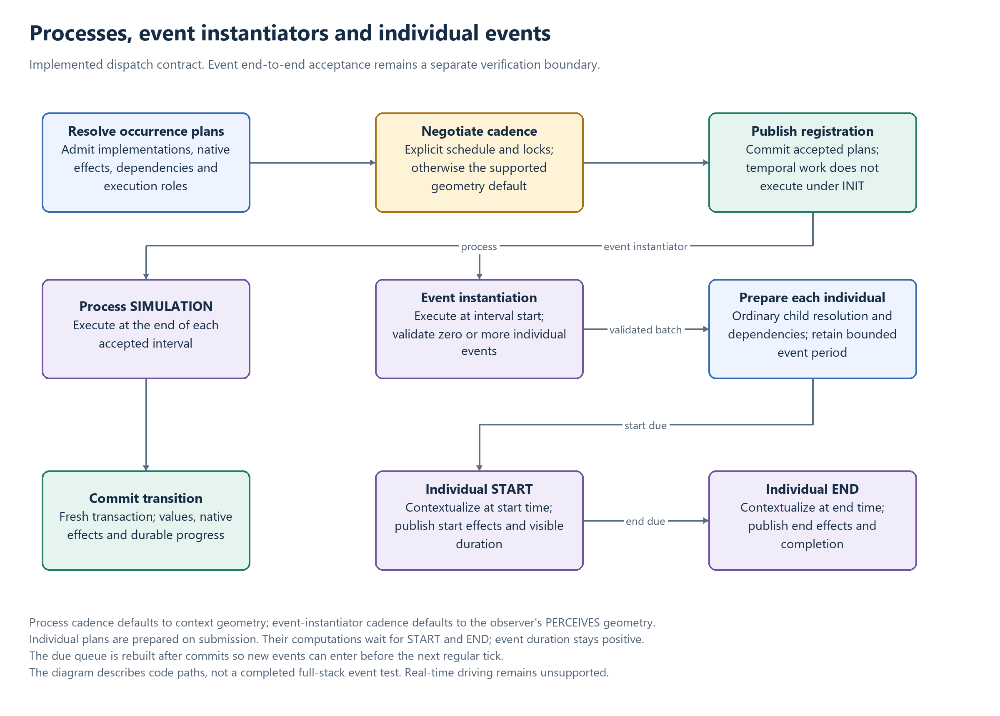

# Occurrence scheduling: processes and events

Processes, collective event instantiators and individual events share the digital twin's
temporal dispatcher, with distinct execution roles and due-time rules. Resolution prepares
their admitted plans, dependencies, native effects and support. Scheduled temporal computation
does not execute as ordinary INIT work.

Read [Resolution](RESOLUTION.md), [Observation semantics](OBSERVATION.md) and
[Admission](ADMISSION.md) for the surrounding publication and evidence contracts.

[Editable diagram](diagrams/occurrence-scheduling.drawio).

## Three temporal roles

| Role | Preparation | Temporal execution |
| --- | --- | --- |
| Process | Resolve dependencies/effects, negotiate cadence, initialize existence and publish occurrence registration | SIMULATION at the end of each accepted interval |
| Collective event instantiator | Resolve the instantiator and publish its accepted cadence | Execute at interval start and produce zero or more validated event individuals |
| Individual event | Validate its period and resolve its plan/dependencies through ordinary submission in the producing attempt | Contextualize the individual at START and END, each with its actual boundary instant |

Individual resolution/preparation and boundary execution are separate. The individual's plan is
prepared when it is submitted, while its event computation waits for the start/end timepoints.
At each boundary the scheduler restores/compiles against the fresh execution scope; a cached
executor must not retain a committed transaction. Temporal effects and progress are published
atomically in that dispatch's transaction.

The event path described here is an implemented code contract. Complete dedicated public event
instantiator/START/END acceptance remains unverified; process acceptance does not establish event
coverage. The verification requirements below identify what must be checked without presenting
the illustration as a successful event test.

## Execution and semantic contracts

- Processes resolve through SIMULATION. Event instantiators register scheduled plans; individual events are observations with their own lifecycle. All relationships are substantials: functional relationships may host processes, structural relationships may not.
- Quality dependencies of processes and individual events select their bearer from semantics. If a quality inheres to the occurrence (including an inherited compatible type), resolve and attribute it there. Otherwise it must inhere to the context observation and the occurrence must `affect` or `create` it. Inherency to the occurrence takes precedence. Missing or incompatible inherency is rejected; an inline assignment does not establish a semantic effect on the context.
- Ordinary quality dependencies complete INIT before the process reads them, under their selected bearer. Their explanatory models need not be listed by the context model. Process registration never executes its temporal computation under INIT.
- A quality connected by `creates` is an epiphenomenon borne by its semantically selected occurrence or context. Its observation and data are materialized only by a successful temporal transition, without a fictitious INIT state. Unavailable prior-state reads are errors.
- Inline `set x to [expression]` accepts a named quality output or `observing` dependency. `set to [expression]` is illegal for a process. Assignments compile against named bindings and run over the quality's localized geometry. Reads use prior causal state; multiple output assignments do not acquire an accidental order through writes.
- Direct `affects` links an occurrent to changed qualities. `marks`, `increases with`, `decreases with`, `discretizes`, and `classifies` specialize `describes` and link qualities. Preserve property class, declared direction and provenance in typed quality-to-quality AFFECTS evidence. Reachability from either affected endpoint does not imply execution order, INIT, or creation.
- `marks` concerns boolean qualities; `discretizes` maps a quantifiable quality to ordering classes under the explaining model's one-to-one mapping; `classifies` defines predicate classification without uniqueness or coverage guarantees.
- Actual recomputation follows resolved model dependency paths. Descriptive reachability alone does not manufacture a computation. Process input bindings remain in actuator HAS_CHILD links and portable plans; they no longer produce reverse quality-to-process prerequisite AFFECTS edges. Existing graph edges are not retroactively migrated.

## Schedule negotiation and geometry defaults

Precedence is dependency observable `@time`, then model `@time`, then Java `@Contextualizer`, then geometry fallback. A higher-precedence request replaces the entire schedule, rather than merging individual fields. Every downstream declared lock and inclusive `minStep`/`maxStep` range still applies; incompatible candidates are rejected so resolution can try alternatives. Model and portable Java metadata use the same native time units and constraints.

Dependency annotations are lexical to that dependency edge and retain requester/model/observable provenance. They do not leak into siblings or unrelated dependency resolution. A dependency schedule is sufficient even when the selected implementation declares no schedule of its own.

When all explicit sources are absent:

- A process inherits cadence from the original context observation geometry, before coverage collapse or temporal localization.
- An event instantiator inherits cadence from the observer's PERCEIVES geometry, not its occupied geometry.
- The source must provide a bounded scheduled temporal extent. A missing time dimension, bare interval without cadence, unavailable perceived geometry, invalid step, or real-time extent is rejected; no arbitrary cadence is invented.
- Preserve the original step multiplier, native calendar unit, phase and bounds. Months and years are never converted to indicative fixed durations. Geometry decoding preserves multipliers such as `2.month`.
- Geometry is a fallback, not a constraint on explicit schedules. An explicit monthly schedule can run over a daily context. Existing downstream compatibility validation still runs during candidate resolution.
- Persist the accepted fallback with CONTEXT_GEOMETRY or OBSERVER_GEOMETRY provenance and the source observation identity. Negotiation version 2 supports these defaults and dependency-only requests; existing version-1 explicit negotiation remains readable.
- Cached/reference reuse checks geometry-derived cadence against the current source and rejects implicit rescheduling. A subsequent geometry change does not silently alter the registered process.

A successful root registration commit activates all its occurrences before requesting advancement to the latest accepted bounded end. Each transition uses a fresh root transaction. Reentrant activation queues another drain instead of recursively executing an unfinished tick. Rollback never activates a registration. A failed transition stops the drain and reports an error while preserving the committed registration and earlier states.

Scheduler construction restores registrations without running models. An explicit advancement or later registration commit resumes unfinished work from durable receipts. Accepted bounds retain automatic-run intent even when the first transition fails. Native calendar recurrence and per-registration cursors support newly introduced historical cadences; equal-time occurrences retain distinct identities. Real-time execution remains explicitly unsupported.

The due queue merges process intervals, event-instantiator intervals and individual boundaries.
It is rebuilt after each commit so newly produced events can enter before the next regular tick.
At an equal instant, event instantiators are considered before individual boundaries, and process
interval execution follows them. A committed temporal cursor belongs to its accepted registration
and plan revision; a mismatched cursor requires re-resolution.

## Individual event production and boundaries

Collective event instantiators execute at the start of each accepted schedule interval, never at
INIT, and may return zero or more individuals. The complete batch is validated before child
resolution begins. Each child resolves through the ordinary submission path within the producing
root transaction; a failed required child prevents that transaction from committing. Individual
plans and dependencies are prepared immediately, while their event computations wait for boundaries.

An individual has one atomic, bounded, positive-duration period, without temporal subdivisions.
Its start must not precede the logical instantiation time. Future starts are allowed; the end may
outlive the producing interval and the instantiator's entire schedule. A one-cell spatial grid is
valid, including geometry expressed using only a bounding box. A physical event never has zero
duration; its two scheduler boundary notifications are instantaneous state transitions.

Individual plans use the portable EVENT execution role. The scheduler merges START and END with
regular schedules, rebuilding the due queue after each commit so newly produced events can enter
before the next tick. A boundary has stable identity `observed:<id>:START|END`; separate durable
completion flags survive retry and restart. Pending events are registered only after successful
commit. An end beyond the current simulation horizon remains pending until the clock advances.

Java contextualizers receive the executing boundary through any `TimeInstant` parameter, and can
inspect `Scheduler.Event.getBoundary()`. Unqualified inline assignments execute at both boundaries.
Portable assignment calls reserve `_eventBoundary=START|END` for future `at start/end set` syntax;
the qualifier is valid only on individual event plans. The source-language syntax is not yet added.

Quality bearer selection remains semantic. Event scanners traverse the event's spatial geometry,
including for context-borne qualities. Inputs open as prior-state snapshots; only qualities
semantically affected by the event receive writable Java scanners. Scalar affected assignments use
the same event view. Closing a writable view scatters explicitly written cells back to native
storage by nearest cell center: cells outside the event remain unchanged. The existing mediation
setting, CRS, rectangular-grid and value-conversion restrictions still apply. Deferred scalar
`creates` outputs use their selected bearer and do not receive a fictitious INIT revision.

Client lookups and graph queries hide pending events. A successful START publishes a version-2
SchedulerJournal carrying `ObservedEvent` (identity, semantic type, name, full geometry, start and
end), inside the existing TransitionCommit envelope. `TransitionHistory.eventsByType()` supplies
one immutable duration record per started event, grouped by canonical semantic type for IDE
lanes. END records do not create duplicate bars, and reordered/replayed delivery converges.

## Storage, no-ops and delivery

Temporal writes use a lazy transaction-owned write set. Merely obtaining a scanner or returning immediately does not allocate a new durable state. Effective value/support changes determine dirty outputs; successful unchanged execution is a no-op, not failure. No-op completion is durable for retry suppression but creates no new Data state, geometry extension, causal recomputation or client timeline clutter.

Changed buffers, Data links, temporal support deltas, provenance and completion commit atomically. Rollback discards provisional output; historical data remains accessible. Downstream computations run only when effective changes reach their resolved inputs. This contract is intended to accommodate later distributed storage/computation implementations without relying on local invocation counts.

TransitionCommit version 1 persists on the root Activity with the graph commit summary, scheduler journals and typed quality-state deltas. ActivityFinished carries committed consequences; history recovery survives messaging outages and client reconnects. Client scopes deduplicate/reconcile delivery and invalidate affected graph/data views before notifying viewers. History polling handles unavailable graphs with bounded backoff. Synthetic ticks without consequences stay out of the Timeline; all successfully committed observed events must ultimately be shown.

Process initialization records existence and schedule activation without inventing a numerical
process INIT state. Later simulation commits retain the activation's causal provenance where
available. Individual-event START/END flags and journals are different completion records from
the instantiator's interval cursor. A committed event may remain pending until its boundary is due.

## Bearers and change requests

Qualities may inhere to processes without making processes countable. Inherited inherency and
applicability bounds still constrain specialization. An ordinary process still needs its own
substantial/event host; it is not an automatic host for another ordinary process.

ProcessPlan version 3 records CONTEXT or OCCURRENT on each quality binding. Querying,
initialization, storage and deferred creation use that bearer. Versions 1/2 retain their defined
context-bearer interpretation; existing observations are not silently reparented.

`change in X` is a valid quality-derived Process meaning regardless of whether a writer model
is available. Only processes/events with supported semantic affects/creates evidence advertise
that output. Existing compatible writers with the correct bearer, observer and complete support
can satisfy CHANGE. Joint-effect preference is bounded by its ranking contract; it is not a
general global set-cover optimizer. See [Consequence engine](CONSEQUENCE_ENGINE.md).

## Event acceptance requirements

Complete event verification must exercise actual instantiator contextualizers and public
submission, not just schedule/geometry helpers:

1. Confirm no temporal instantiation under INIT, then dispatch at accepted interval starts.
2. Validate complete batches before child resolution; reject an invalid or failed required
   child without publishing a partial batch.
3. Check individual resolution/preparation, positive atomic duration, future starts and ends
   beyond the producing interval/horizon.
4. Execute both START and END with correct TimeInstant/boundary arguments and actual numerical
   effects. Test read-only versus affected scanners and untouched cells outside event support.
5. Fail genuine work and verify atomic rollback, retry/restart flags, cursor ownership and
   immutable earlier state. A failed or unexecuted transition is not a durable no-op.
6. Verify due-queue rebuilding, downstream recomputation, pending/current projection and event
   duration history through reconnect/reordered delivery. END must not duplicate the START bar.
7. Verify live client rendering and causal navigation independently of service/transport checks.

Focused geometry, event-support, registration, scanner-binding, dispatch, temporal storage and
transport tests exercise individual boundaries. They do not substitute for complete event
lifecycle coverage. Keep the event acceptance gap explicit until the public path is exercised.

## Open execution contracts

Real-time driving is rejected until clock switching, outage/catch-up, concurrency and operational
stop/resume policies are defined. General distributed writeback and behavior-driven recursive
production require separate contracts.

Behavior-driven create/move/retire operations need versioned mutation envelopes with stable
identities, causal/action provenance, temporal support and base/result revisions. Occupied
geometry, perceived geometry, existence and computed support remain distinct. Retirement is
a temporal tombstone, not deletion. Authorization, competing mutations, spatial conflict,
cascading retirement and behavior transaction entry must be specified before those operations
are enabled. Quality delta transport alone does not supply them.
