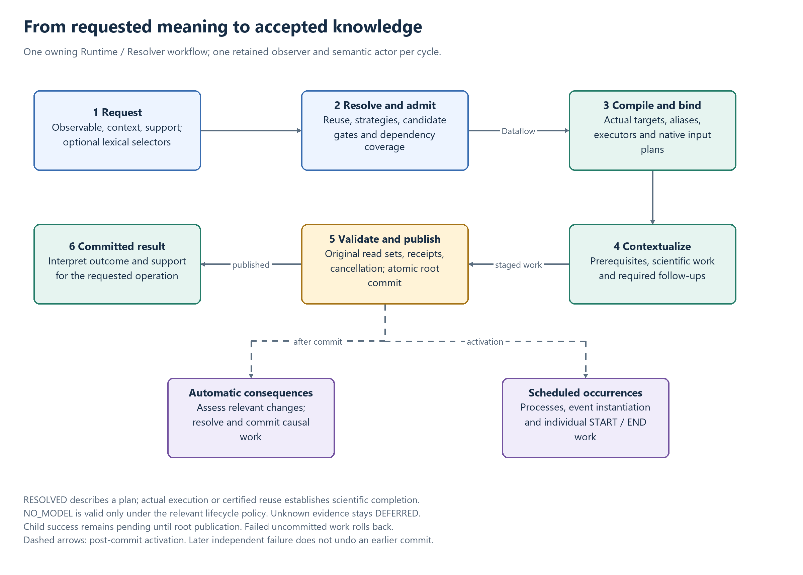
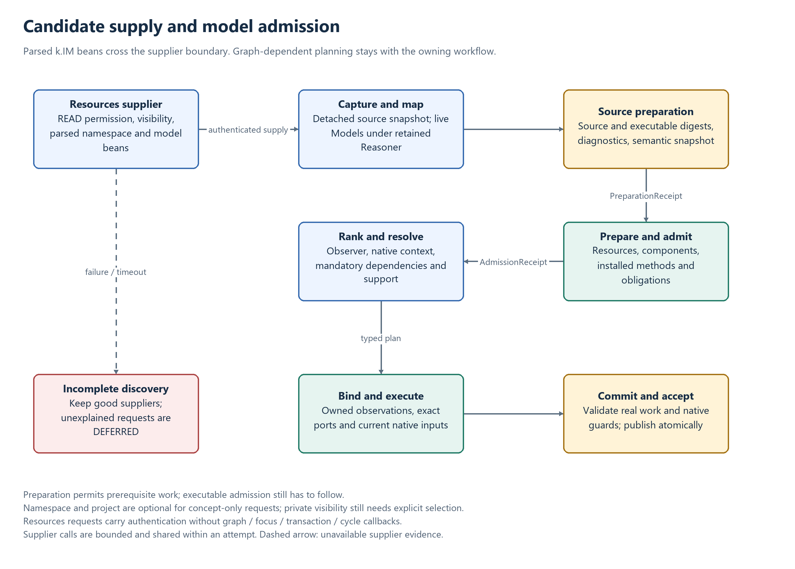
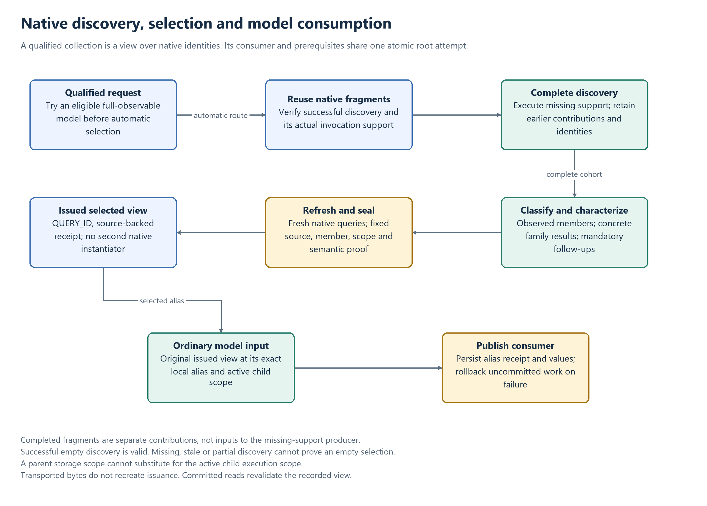

# Observation resolution in k.LAB

Resolution constructs an explanation for an observation request in its selected context.
It returns a portable contextual Dataflow; Runtime validates and executes that plan and
publishes the resulting knowledge. Finding a model, planning coverage and producing values
are distinct facts.

See [Observation semantics and strategies](OBSERVATION.md), [Admission](ADMISSION.md),
[Observers](OBSERVERS.md) and [Dataflow reconstruction](DATAFLOW.md).

## Resolution, contextualization and acceptance

[Editable diagram](diagrams/observation-lifecycle.drawio).

1. **Establish the request.** Runtime resolves the observable and effective scope, establishes
   support and observer, and admits the resolution cycle. An application may submit a concept
   URN without specifying a model namespace or project.
2. **Register planning identities.** Unresolved observations receive provisional identities
   owned by the active root transaction. Registration supports planning; rejected candidates
   do not thereby enter the commit graph.
3. **Resolve.** The committed Resolver queries current observations, obtains applicable
   strategies, discovers parsed model candidates, admits them, and resolves dependencies and
   coverage. Direct whole-observable alternatives precede automatic recursive routes.
4. **Compile the Dataflow.** The Resolver emits typed actuators, bindings and computations.
   Runtime checks their source, semantic, context and native-input contracts, discharges
   supported deferred prerequisites, and constructs executors and storage.
5. **Contextualize.** The scheduler initializes prerequisites and executes the scientific
   activities required by the observable. A dependency-only consumer still retains its actual
   input plan. Successful child work can remain staged in the root attempt.
6. **Validate and publish.** Runtime checks cancellation, model/input proofs and native read
   guards before root commit. A successful root commit publishes identities, effects, values,
   plans and provenance atomically. A failed attempt cannot certify discovery or selected inputs.
7. **Continue the cycle.** Post-commit activation and automatic consequences run outside the
   transaction graph monitor. Scheduled process simulation, event instantiation/individual boundaries and consequence
   work use their own guarded commits. The next explicit cycle begins after causal work in the current cycle drains.

An internal resolution commit may be a child commit. It does not imply that the enclosing
submission has published or contextualization succeeded. Conversely, a subsequent background
failure cannot retroactively undo a successful triggering commit.

## Service ownership and candidate supply

A ContextScope commits to one Runtime and one Resolver. They share access to its knowledge
graph. “Local” identifies this owning workflow, independently of hostnames or deployment sites.
Resources may reconstruct the requester but cannot assume it can query a non-public Runtime.

Resources therefore acts as a supplier during model discovery. It returns parsed k.IM beans,
including namespace/model/observable structure and the source retained by their contract.
The Resolver constructs live `Model` objects using its retained Reasoner; it does not ask a
remote Resources service to perform the owning workflow's graph-dependent admission.

[Editable diagram](diagrams/model-admission.drawio).

Candidate and source/artifact requests carry user/federation authentication and optional lexical
namespace/project/scenario selection, without graph, focus, transaction or cycle callbacks.
Public candidates require no namespace/project selection. Private/project-private visibility
and supplier READ permission still apply. An omitted selector is not an access grant.

The `modelCandidateProtocol=1` capability selects the candidate endpoint. A protocol-0 provider
uses authenticated namespace listing. It is not probed for an unadvertised route and does not
fall back to a context-bound semantic query. See [Resources](RESOURCES.md#candidate-source-supply).

## Scope, identity and operation binding

| Identity | Meaning |
| --- | --- |
| `Observation.UNASSIGNED_ID` (`-1`) | An unregistered request; Runtime registers it before Resolver planning |
| ID below `-1` | A provisional identity owned by the active root transaction |
| `Observation.QUERY_ID` (`0`) | A transient query/view; never a stored observation identity |
| Positive ID | A durable identity; currentness, completion and permitted reuse still need checking |

The owning provisional registry is separate from transaction graph assets and is discarded at
root completion/failure. Planning lookups and current-asset lookups enforce different contracts;
see [Planning ownership](ADMISSION.md#planning-ownership-and-operative-lifecycle-are-different).

An ordinary independent substantial submission resets inherited observation focus, preserving
observer and resolution constraints. Quality submissions retain their bearer. Concrete collective
selection retains its explicit native focus. Nested member registration retains the producing
collective's ownership, while independent member resolution follows its own scope rule.

Model dependencies use the model's lexical namespace/project without mutating the parent scope.
Instantiation outcomes carry the producing model's computation constraints into individual
submissions. A provisional substantial selected as a model context is retrievable through the
owning transaction's admission lookup, including across Runtime/Resolver/Reasoner HTTP boundaries.

Operations on existing observations use `OperationTarget` and UPDATE actuators. Their identity
is a plan-node identity, not an observation allocated for the directive. Execution targets,
operation observable, support and member bindings remain explicit through transport and recovery.

## Strategy search and model resolution

`ResolverService.resolve` creates a compiler for the attempt. `ResolutionCompiler` first queries
current Runtime knowledge with the complete observable, support, scope and observer contract.
A valid reference can fulfil the obligation without new computation. Mere identity or planned
geometry is not a current completion certificate.

Strategies are tried by ascending rank until the required coverage is satisfied. Within a
strategy, RESOLVE recursively explains an observable; OBSERVE searches for models of it.
Required inputs must resolve in their own relevant support. Optional inputs can be absent only
under their explicit policy; their absence cannot certify unknown discovery as NO_MODEL.

For a model candidate:

1. Capture and map its authorized provider source snapshot with the retained Reasoner.
2. Prove a source `PreparationReceipt` before allowing prerequisite preparation.
3. Resolve installed components/resources/contextualizers under its lexical scope.
4. Obtain executable admission and retained obligations; compare source/executable snapshots.
5. Enforce observer and required-context compatibility, then rank eligible candidates.
6. Resolve mandatory dependencies, retain named bindings, and merge their relevant coverage.
7. Recheck proofs where entering a different modeled context changes the applicable contract.

Preparation is scoped to the model and its scope witness. A catalog hit, a cache hit, a pending
context obligation or a high ranking never independently authorizes execution.

### Model ranking

Prioritization orders model candidates for one `observe` operation. It does not rank observation
strategies, change their tiers, establish coverage or execute a model. Resources supplies authenticated, immutable candidate source snapshots without joining the
ContextScope graph workflow. The committed Resolver maps them with its retained Reasoner,
excludes those without a compatible output,
prepares their ranking and tries them in order. A highly ranked model can still fail to resolve its
dependencies; subsequent candidates may supply all or part of the required coverage.

#### Inputs, direction and lifetime

`PrioritizerImpl` receives the request Observable, context observable, requested Scale, context
scope and service ranking configuration. It captures lexical constraints and maintains request-local
caches for semantic distance, spatial/temporal calculations and criterion maps. Inputs must remain
stable during that ranking session. The object is not shared between resolution attempts and is not
a service-transport bean.

Semantic compatibility always uses `Reasoner.semanticDistance(candidateOutput, request, context)`.
For multi-output models the lowest nonnegative output distance is used. No compatible output gives
`Integer.MAX_VALUE`; Resolver excludes that model even if the semantic-distance ranking criterion
is disabled. Reasoner/service errors propagate rather than becoming a poor but usable score.
`Reasoner.resolves(request, candidate, context)` expresses the same capability with request-first
arguments. Semantic distance applies to all observables, including inherency and other clauses;
predicate heads may admit subsumption while non-predicate heads retain their equality requirement.

#### One comparison policy

Configuration maps criterion property names to integer priorities. Positive values enable criteria,
smaller values run first, and nonpositive values disable criteria. These integers are ordering
positions, not weights. Equal priorities use alphabetical property-name order; no weighted
aggregation is implied. Unknown keys and null priorities are configuration errors.

The effective `ResolutionNamespace` constraint in the submission/resolution scope selects the
namespace whose `KimNamespace.getResolutionCriteria()` overrides service defaults. That single
policy applies to every candidate, irrespective of its namespace. Candidate
`Model.ResolutionInfo` criteria are descriptive metadata and never choose the comparator.
The namespace is retrieved through the existing Resources API even when none of its models
are candidates. No namespace constraint or an empty namespace policy means service defaults;
an unavailable namespace produces a warning and uses defaults. Retrieval errors propagate.

The policy is captured when the ranking session is created. ResolutionNamespace is a replacing,
not accumulating, constraint: when resolution enters a model's dependencies, the model namespace
becomes the effective namespace in that child scope. A new ranking session therefore uses that
namespace's policy without changing the parent's session. For example, a request in namespace A
uses A's order to compare models from A and B; dependencies of a selected B model use B's order.
Different namespace policies do not conflict because they govern different ranking sessions.

Members produced by INSTANTIATION are a further explicit handoff: their individual submissions
adopt the producing instantiation model's namespace and project, rather than the submission's
original namespace. The compiled Actuator carries `computationConstraints`, keyed by computation
index, through interface-based JSON transport. Runtime binds each executor's new outcomes to those
lexical constraints and applies them to each member's submission scope. Collective registration,
transaction/provenance and other constraints remain inherited; the parent scope is unchanged.
When several instantiators contribute members, each member uses its own producer's policy.
Absent producer bindings inherit the execution scope; unrelated model metadata cannot select it.

Members default to individual secondary resolution. The
[`@resolution` instantiation policy](INSTANTIATION_RESOLUTION.md) also supports existence-only
acknowledgment (`none`) and one explanatory selection over the full contextualized producer
support (`collective`). Shared planning retains independent child binding, coverage checks,
execution and atomic publication. An originating observation annotation, supplied by its builder
or k.IM `define`, overrides producer policies across all instantiations in its explanation.
Without that override, policies remain local to each producing computation and its outcomes.

The namespace policy map is a portable bean property using the existing Jackson interface mapping.
Current source adaptation does not yet populate it from a namespace ranking declaration; the
property defaults to empty. Defining a source spelling and adapting it is separate from this
policy-selection contract.

Comparison is lexicographic. Semantic distance is ascending (zero is exact; distances are not
capped). All implemented benefit scores descend. Equal score vectors use model URN in lexical order,
with missing URNs last. Candidates sharing the same scores and URN compare equal; choosing between
different revisions under the same identity requires a version-selection policy outside Prioritizer.
An empty criterion order still uses this deterministic identity tie-break. The selected policy is immutable for the session.

Service defaults place lexical scope first and semantic distance second. The remaining configured
order is trait concordance, evidence, time specificity, time coverage, space specificity, space
coverage, subjective concordance and inherency. Some are vocabulary placeholders, as below; their
configuration does not make them implemented. Disabled criteria are absent from ranking maps.

#### Criteria and score semantics

| Criterion | Calculation and direction |
|---|---|
| `im:lexical-scope` | Descending: generated model without namespace or active scenario 100; resolution namespace 75; same non-null project 50; other visible model 0. Scope ranking does not grant access. |
| `im:semantic-concordance` | Ascending minimum compatible semantic distance over model outputs; exact 0, broader compatible meanings positive. |
| `im:space-coverage` | Descending `100 × area(intersection) / area(request)` in square metres. |
| `im:space-specificity` | Descending `100 × area(intersection) / area(model)`. A more narrowly applicable model scores higher when it covers the request. |
| `im:time-coverage` | Descending `100 × duration(intersection) / duration(request)`. |
| `im:time-specificity` | Descending `100 × duration(intersection) / duration(model)`. |
| Trait concordance, inherency, evidence, network remoteness, subjective concordance, reliability | Not implemented as independent criteria; score -1 and listed by `unsupportedCriteria()`. Inherency already contributes to semantic distance. |
| Combined scale coverage/specificity/coherency; spatial and temporal coherency | Not implemented; score -1. Aggregation across dimensions and resolution-fidelity policy remain to be defined. |

Benefit scores are finite and bounded to 0–100 when available. `-1` explicitly means unavailable,
not zero coverage. All candidates receive the same unavailable value for an unsupported criterion,
so it cannot discriminate. `listCriteria()` returns active property names in order;
`unsupportedCriteria()` exposes the active unimplemented subset. `getRanking(model)` computes on
demand and returns an immutable criterion map, as does `computeCriteria(model)`. Preparation also
computes the single-candidate case, which ordinary sorting would not visit. These are local
inspection methods; they do not automatically persist ranking metadata in Activities or Dataflows.

#### Geometry and time boundaries

Portable model geometry is decoded through GeometryRepository before reading extents. A missing
model coverage or absent model/request dimension yields unavailable scores for that dimension.
Explicit universal model coverage yields coverage 100 and specificity 0 in a requested dimension;
it is distinct from missing coverage. Spatial intersections use the shape's projection-aware
operations and square-metre areas. Disjoint or empty shapes score zero. Degenerate/nonfinite area
denominators yield unavailable ratios rather than NaN or infinity. Point/line resolution-fidelity
ranking requires a separate policy; polygon area ratios do not invent one. Geometry errors propagate;
there is no arbitrary positive fallback score after a topology failure.

Temporal intervals use overlap duration, so disjoint intervals score zero rather than receiving a
positive distance-based bonus. A bounded request is needed; missing request endpoints yield
unavailable scores. Open model endpoints act as unbounded limits: a covering open interval has full
coverage and zero duration-specificity. The public `computeTemporalCriteria` helper retains `-1`
as the open-model-endpoint sentinel; the model-based path uses nullable bounds so an actual timestamp
of -1 is not confused with absence. Reversed bounds are errors. A point request scores coverage 100
when contained by the model interval and specificity 100 only for the same model point; otherwise
these point scores are zero. Coherency remains unavailable because sampling resolution is not the
same as interval overlap.

Model ingestion currently assigns universal coverage in source-to-model mapping. Ranking
cannot recover a model's true spatial or temporal limits from that placeholder. Coverage scores
therefore describe the supplied model contract, not a proof of executable resource availability.

#### Remaining policy decisions

Define evidence, reliability, locality and subjective-ranking
sources and scales before activating those criteria. Specify cross-dimension aggregation and
spatial/temporal resolution fidelity before implementing coherency or combined scale scores.
Neither deterministic ordering nor a high score substitutes for eligibility constraints such as
blacklists, whitelists or `UsingModel`; their enforcement belongs to discovery/resolution.
Not every ResolutionConstraint variant has an implemented enforcement path. Serializing a
constraint alone does not prove it is enforced; each additional policy requires an explicit
discovery/resolution contract and negative controls.

## Coverage and references

`Geometry` describes support; `Coverage` additionally records how much of the requested domain
an explanation fulfils. Resolver Coverage implementations do not cross service transport: use a
portable geometry projection and resolved fraction. Scalar, universal and empty domains retain
their separate meanings; see [Geometry](OBSERVATION.md#geometry-and-scale-contract).

Union accepted alternative coverage without double-counting overlap. Intersect required input
coverage with the result obligation; a dependent graph cannot compensate for a missing input.
Preserve measured partial support when complete fulfilment is unavailable. Missing or
unrepresentable support must not become a success claim.

A reference identifies knowledge already available to the requesting scope. It does not copy
values into an output or provide an implicit resampling, redistribution or overlap policy.
Mixed model/reference outputs requiring value composition must have an explicit supported
operator. Temporal exclusion that cannot represent an exact complement uses a conservative
domain; it does not invent an interval gap.

The `ResolutionGraph` is an intermediate semantic explanation containing observations,
strategies, models, operation targets and coverage-bearing edges. Its context object and
attempt-local state do not constitute a durable reuse catalog. Runtime's authoritative graph
and completion receipts govern cross-request reuse.

## Portable Dataflow and runtime compilation

`DataflowCompiler` translates accepted graph contributions into Actuator trees with local
names, requested/resolved support, computations, target bindings, producing-model admission
and deferred prerequisites. `CompiledDataflow` checks and binds these to actual Runtime assets.
The submitted root retains its identity, native parent and support. Transport copies must
not allocate a duplicate root or replace a bound target silently.

`computationConstraints` bind produced outcomes to the correct lexical model scope. Runtime
retains input plans even for consumers without computation, since scheduler initialization
must validate their computational prerequisites independently of executor presence.

Jackson interface mappings carry Dataflow, Actuator, observations, calls, geometry and nested
bindings. Source beans remain portable API objects. JSON bytes are neither execution authority
nor a whole-context reproduction document. [FlowCharts](FLOWCHARTS.md) expose the chosen
resolution graph and execution plan as separate views.

## Semantic-update contextualizations

CLASSIFICATION resolves members before executing a classifier for the full predicate-of-each-
substantial directive. Runtime binds observed members to the operation, validates concrete,
satisfiable results and stages attribution on those same identities. New attributions require
CHARACTERIZATION; actual characterization records CHARACTERIZED effects, while a legitimate
no-model decision records resolution without an invented execution effect.

UPDATE actuators carry `effect = SEMANTIC_UPDATE`, `operationObservable`, contextualization,
requested support and typed `COHORT_MEMBERS` or `OBSERVATION` bindings. They do not allocate
directive observations, value storage or independent scheduler entries. Required ordinary
model and member-quality dependencies execute in order before their consumer.

The Runtime validates both durable and transaction-local native members, including ancestor
transaction contributions. A sibling/root failure invalidates uncommitted success. Enumeration
deduplicates identities and respects actual support. Completed empty discovery is successful;
missing discovery is not. See [Classification](CLASSIFICATION.md),
[Member-quality collections](MEMBER_QUALITY_COLLECTIONS.md) and
[Dependency families](CLASSIFIER_DEPENDENCY_FAMILIES.md).

## Collective selection and consumer continuation

The automatic positive concrete-predicate selection route is used after eligible full-observable
models. It completes native discovery, executes required family classifiers, and returns a
virtual selected view with scoped semantic/native evidence. A selected ordinary-model dependency
is retained as a deferred reference and expanded within the consumer's root attempt.

Partial discovery contributes completed fragments alongside newly executed producers. The old
fragments are not producer inputs. Before sealing, native reference roots are refreshed from
current completed queries because the successful contributors may have changed during the attempt.
Classification/member/support checks remain mandatory for the full requested collection.

The original issued selected view is attached to its exact compiled local port. Its private
capability binds consumer, cohort, transaction and plan. Storage uses the compiler's execution
scope, including an active child transaction; a root storage scope is not interchangeable with
that child. Scope child-count bookkeeping is excluded from scope identity, while the selected
view's own count and payload remain exact. Serialized copies cannot manufacture issuance.

At execution, retained/transported selected references are read-only revalidated before use.
Successful consumers persist their alias-to-selection receipts as JSON. Consumer failure rolls
back newly discovered members, classifications and consumer outputs in the uncommitted attempt.
See [Collective completion](COLLECTIVE_COMPLETION.md) and
[Selected-input admission](ADMISSION.md#selected-query-inputs).

## Outcomes and result acceptance

| Dataflow outcome | Meaning |
| --- | --- |
| `RESOLVED` | A plan is available; evaluate its coverage and subsequently execute/validate it |
| `DEFERRED` | Evidence/work is incomplete; supported deferred classifier/selection prerequisites may be resumed, while unavailable supplier evidence cannot certify absence |
| `NO_MODEL` | An affirmative no-explanation decision after complete applicable discovery; permitted lifecycle uses do not invent computation |
| `FAILED` | Resolution failed; it is not an empty successful result |

Acknowledgment can accept an error-free explicit NO_MODEL decision. Optional characterization
can accept genuine absence of a model, while a matching but unresolvable model is a failure.
A no-model Dataflow is a valid, non-empty decision with no computation. An empty observation
failure sentinel is a different object and must not be used as scientific evidence.

Scientific acceptance additionally checks current lifecycle, correct meaning/bearer/observer,
required support, actual successful execution or certified reuse, and publication. Consequence
handlers require their operation-specific completion evidence. A positive ID proves neither
values nor execution, and a non-null response alone does not prove a successful submission.

## Transactions, scheduling and provenance

Submission, resolution, prerequisite and contextualization activities can form a shared root
attempt. Child commits retain staged changes and validation state. Root publication allocates
durable identities, checks the original native read sets and makes accepted changes visible.
Cancellation or failure stops new work and prevents publication of the uncommitted attempt;
already published independent commits remain part of history.

Process initialization records existence and occurrence registration without manufacturing an
initial numerical process state. Later SIMULATION activities are independent transactions,
causally linked to the retained initialization where available, including scheduler recovery.
The absence of a separate numerical INIT contextualizer on the process is not a missing
scientific computation. Explicitly retained mismatched activation evidence fails recovery.

Collective event instantiators use the same temporal scheduling machinery, dispatching at
interval starts. Each produced individual event is validated and resolved/prepared through
ordinary child submission in the producing transaction. Its computation is then scheduled at
its separate START and END timepoints. Boundary execution uses the accepted individual plan
and a fresh guarded scope; pending/start/end state and actual effects commit atomically.
Process cadence defaults to context geometry, while event-instantiator cadence defaults to the
selected observer's perceived geometry. See [Occurrence scheduling](OCCURRENCE.md).
The event implementation's complete public-path acceptance remains a separate unverified boundary.

Post-commit callbacks run after transaction cleanup, outside the graph monitor, while the cycle
driver remains held. Consequence commits are separate from the triggering commit and use their
own cause and client messages. See [Provenance](PROVENANCE.md) and
[Consequence cycles](CONSEQUENCE_ENGINE.md#frozen-resolutioncontextualization-cycles).

## Observer-aware resolution contract

**Agreed target behavior, not fully implemented.** Observer semantics are defined in
[Observable expressions](OBSERVABLES.md#observer-perspective-contract). An explicit `observed as X`
query and a query with only a session/context observer are different requests even when their
effective observer class is the same.

Select the effective observer by precedence: an observer URN in the submission resolution
constraints overrides the session/context observer; otherwise use the session observer, including
null. The override applies only to that submission and does not mutate the session default.
The selected observation may be any eligible Agent in the knowledge graph, not only the
session observer created with the context. Preserve the selected observation/URN separately from
its semantic Agent class and from whether the query explicitly contains `observed as`. A selection
constraint alone does not introduce that clause, so it does not turn prioritization into a hard
observer compatibility requirement. Validation, access and graph-membership checks remain required.

| Query | Eligibility with respect to observer | Selection/fallback |
|---|---|---|
| Explicit `observed as X` | Require compatible explicit observer semantics under normal clause specialization. Absolute/null candidates are ineligible. | Compare only eligible candidates; no absolute fallback, even if specific dependencies fail. |
| No explicit observer clause; context observer X | Compatible observer-specific and absolute/null candidates remain eligible. Other incompatibilities still reject a candidate. | Prefer compatible candidates specific to current observer X; if their resolution fails, including unresolved dependencies, try absolute candidates. Mere catalog availability does not suppress a usable fallback. |
| No explicit observer clause; null context default | Absolute/null candidates remain observer-eligible; do not manufacture an observer class. | Detailed ordering of specific candidates without a current observer is not settled here. |

Compatibility/admission precedes semantic distance and prioritization. Specificity is a preference
among compatible candidates, never permission to ignore a query clause. Preserve this ordering for
both **observation reuse** and **model discovery/ranking**: reusing an absolute observation must not
prematurely suppress an available compatible specific resolution, while a failing specific model
must not block allowed absolute fallback. Existing coverage and partial-fulfillment semantics still
apply; this contract does not turn observer selection into a new coverage guarantee.

A modeled Agent observation can supply the observer, and multiple perspectives can coexist in one
knowledge graph. Store explicit observer meaning separately from session interpretation of null.
Identity/reuse and positive/negative resolution caches must account for query explicitness, relevant
observer semantics and scoped observer identity, applicable semantic/knowledge/model revisions and
access context. A default-observer change must not reuse an incompatible prior ranking or failure;
the same applies to a submission constraint selecting a different observer observation, even when
its Agent class equals that of another observer. Do not equate instance identity with class identity.
Observer selection also must not relabel globally stored absolute observations. Verify these requirements against
existing identity, scope and revision mechanisms rather than invent a second cache system.

Positive example: an implicit query with context observer X prefers a compatible X-specific model;
if its dependencies cannot resolve, a compatible absolute model can be tried. Negative examples:
an explicit `observed as X` query cannot use that absolute model; an unrelated observer Y is not made
eligible by a better numeric score. Names X/Y are schematic, not worldview declarations.

The implementation preserves full observable wrappers through the revision-bound HTTP distance
route, checks explicit observer compatibility before scoring, and partitions eligible model choices
by the implicit observer preference within each existing strategy phase. A successful Tier-0 answer
still precedes expensive Tier-1+ recursive discovery. A committed absolute quality/process result
is deferred while compatible specific planning is attempted; planning dependency failure can fall
back to that result without executing an otherwise unnecessary absolute model or recursive route.
Specific models may satisfy coverage through the existing model-planning path. If they cannot
complete the request, a complete eligible absolute source remains a terminal fallback. The observer
path does not join a partial specific model to an absolute reference and falsely claim filled values:
a reference input or provenance receipt is not an output value-copy operator.
The current one-result lookup chooses a complete eligible occurrence before an incomplete one:
a narrow specific occurrence cannot hide a complete absolute fallback. With no complete match,
its measured partial support is retained for planning. This lookup does not yet compose several
already committed perspectives into one new dependent aggregate; that requires an explicit
value-composition path, not multiple reference roots mislabeled as a computed result.
Mixed observer-specific model/reference output composition is likewise unfinished and rejected
without such an operator. Its future implementation must define native support, overlap precedence,
value mediation and contribution provenance. Existing temporal complement limitations also remain;
no exact residual interval is inferred when exclusion cannot represent it.

The original operation/query remains implicit when a verified producing output refines the result's
observer meaning. Rebinding execution targets does not overwrite that operation. Terminal reference
reuse preserves the committed source's identity and metadata, skips computation/storage creation,
and records source ID/URN in activity provenance rather than staging the source as a newly committed
observation. Submission coalescing retains the selected observer ID and full observable identity.

Both model catalog backends use the full stored observable wrapper, not the indexed base Concept,
for revision-bound compatibility after source admission. Named secondary output descriptors preserve
the observer clause through required inherency specialization. Server observer selection from
submission constraints and contextualization headers uses owning-context queries before attaching
request transactions. Ordinary actuator storage preserves the original operation observable for
cold reconstruction independently of the resolved result.

Submission, contextualization and autonomous simulation activities record the selected Agent ID
and its provenance edge, or explicit known-null. Autonomous scheduler replay recovers the actual
Agent through creation/activity provenance before execution, inside its failure boundary; it never
substitutes the semantic observer class. Each creator branch must independently establish the same
selection. Unknown legacy records, conflicting branches, cycles without an authoritative selection,
corrupt markers and inaccessible Agents reject recovery with an actionable resubmission diagnostic.
Known-null is valid and clears the recovered execution observer. The current default and a parent's
selection must not fill missing historical evidence. Explicit dependency execution keeps its supplied
request scope.

Perspective enumeration is separate from resolution eligibility and preference.
`getPerspectives(observable)` returns all existing observation records visible at the querying
scope's knowledge-graph insertion point with the same canonical semantics after removing only
the `observed as` restriction. It does not apply arbitrary subtype compatibility, selected-observer
ranking, best-support selection, aggregation or model resolution. Preserve every other semantic
clause, including portable mediator definitions and distribution flags. Enumeration performs no
unit/currency conversion. Absolute/no-clause observations use the same equality rule. Multiple records by one actual
Agent, including different supports or occurrences, must all remain in the result; actual Agent
identity must not be substituted for the semantic observer restriction. Scope visibility remains
mandatory. Qualities are the intended primary use; substantial perspectives remain legal for now.
None of this weakens the explicit observer compatibility constraint on a new resolution request.

The fallback guarantee here covers ordinary dependency resolution during planning. Deferred
executable classifier prerequisites run after model selection and may affect a shared transaction;
a failure there is not yet a safe alternative-model retry. No rollback/retry policy after stateful
execution is implied. Tests of pending transaction graphs and stubbed commit I/O do not demonstrate
durable storage or live-stack acceptance. Null-context ordering of observer-specific candidates also
remains unspecified. These boundaries must remain visible when extending classifier or recursive
execution, rather than silently broadening observer fallback.

## Cycle observer and discovery latency

The selected observer and retained semantic actor stay fixed through the admitted cycle and
its consequences. Native graph revisions do not reconstruct that observer inside the cycle.
Explicit requests in the same twin wait for the active cycle to drain; causal children inherit
it and must not queue behind their own parent. Unrelated twins are independent.

Supplier calls run concurrently with a total per-supplier budget covering negotiation, transfer
and compatibility fallback. The default is ten seconds; `klab.resources.candidateTimeoutSeconds`
accepts values from one to 300 seconds. Timeout/failure is retained for the attempt, including
concurrent dependency queries. A subsequent attempt may retry the provider.

One detached supplier response is retained per provider and lexical selection in an attempt.
Mapped templates are keyed by requesting identity, retained actor/cycle, supplier, source hash
and model member. Each consumer receives a detached copy before preparation. Requested-core
filtering and resolving-head expansion avoid repeated semantic work; caches supply no admission
grant and do not cross their declared revision/attempt boundaries.

Reasoner resolving-closure caches are bounded and revision/refinement-scoped. Property and axiom
memoization inside OWL bounds evaluation is checked against the same ontology/reasoner lease.
Resources catalog reconciliation cooperates with active semantic cycles. Namespace validation is
driven by source or semantic validity changes; opening an unchanged IDE workspace is not a reason
to validate every namespace again. Runtime admission still validates its applicable receipt.

The resolution graph retains each selected producer's original admission evidence. Dataflow
compilation checks its model identity, namespace, executable digest and retained semantic
binding, then carries the same receipt and producing-model snapshot into Runtime. The
observer-contribution branch uses that original revision rather than admitting the model
again after planning. Later source/semantic publications do not replace the admitted view;
an incompatible or missing original proof requires a new plan. Execution binding, coverage,
native read guards and publication checks remain separate obligations.

Pure semantic RPCs omit unused focus/observer/transaction routing; capabilities retains caller
permissions and semantic-cycle identity. Scope-consuming operations retain the full required
context. These distinctions prevent unnecessary native callbacks without weakening ownership.

Use the `Model query timing`, resolution-attempt semantic totals, slow Reasoner phase timings,
cycle admission and submission-preparation logs to locate delays. Distinguish provider wait,
actor-lock contention, source mapping, document validation, planning and execution. Cache warmth,
selected models and actual schedules affect timings; fixed wall-clock targets are not part of
the acceptance contract.

## Reconstruction and current limits

The contextual response is incremental. General export of a selected graph, observation-language
source generation, import and strict/adaptive replay are separate from ordinary resolution and
from scheduler recovery. See [Dataflow reconstruction](DATAFLOW.md).

Other explicit boundaries include general typed graph merges and context/member composition,
arbitrary native-to-regional resampling, mixed perspective value composition, and unsupported
ranking/coherency criteria. A grammar production or an API placeholder does not authorize a
partial implementation to claim success. Missing supplier evidence remains DEFERRED; unknown
completion remains unknown. Preserve those boundaries when adding a new execution route.

## Implementation map and verification

| Responsibility | Implementation |
| --- | --- |
| Recursive planning | `ResolverService`, `ResolutionCompiler`, `ResolutionGraph` |
| Parsed candidate mapping and admission | `SourceModelMapper`, `ModelCandidateSources`, `ModelValidationGate`, `PrioritizerImpl` |
| Portable plan construction | `DataflowCompiler` |
| Owned registration, submission and publication | `RuntimeService`, `ServiceContextScope`, `DigitalTwinImpl.TransactionImpl` |
| Executable binding | `CompiledDataflow`, `SelectedQueryInput` |
| Prerequisite continuations | `CollectiveSelectionContinuation`, `SelectedModelClassifierContinuation`, `ClassifierDependencyContinuation` |
| Native evidence and scheduling | `SemanticExecutionEvidence`, `KnowledgeGraphNeo4j`, `SchedulerImpl`, `ResolutionCycles` |

Use source/transport tests for bean and header invariants, planning tests for coverage and
bindings, and native execution tests for effects, storage, rollback and recovery. Public submission
regressions must keep root and child scopes distinct and retain real historical provenance when
checking committed replay/inspection. See [Acceptance checks](ADMISSION.md#acceptance-checks).
