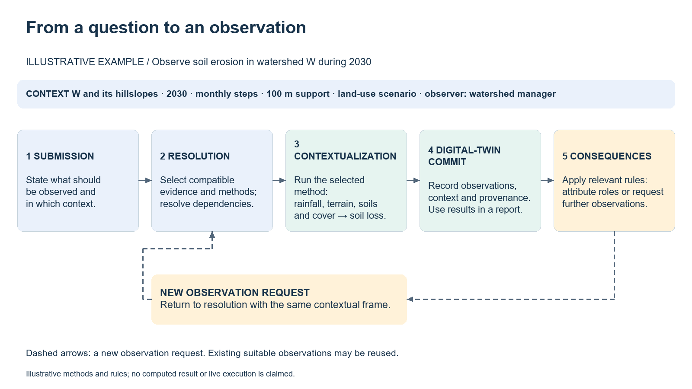
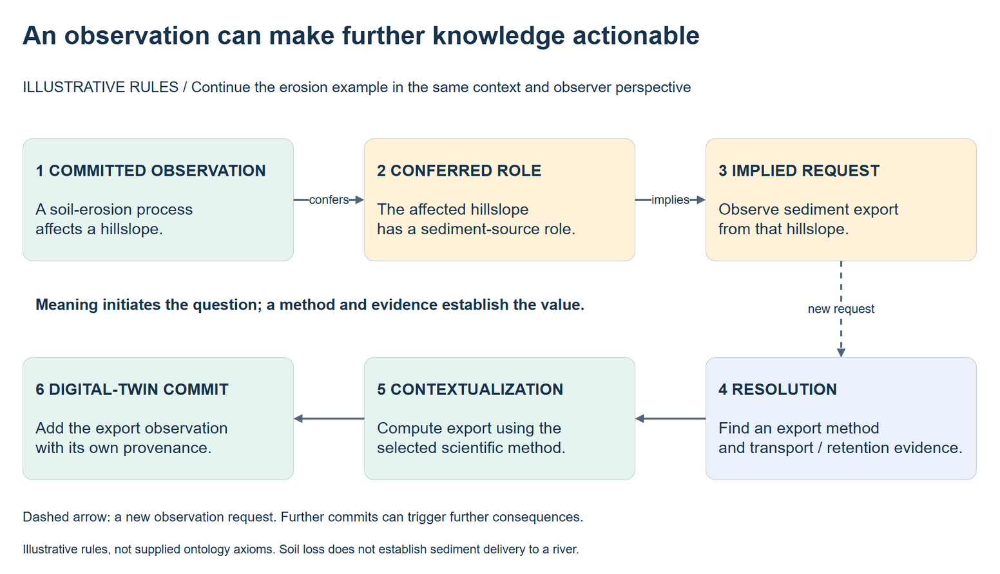
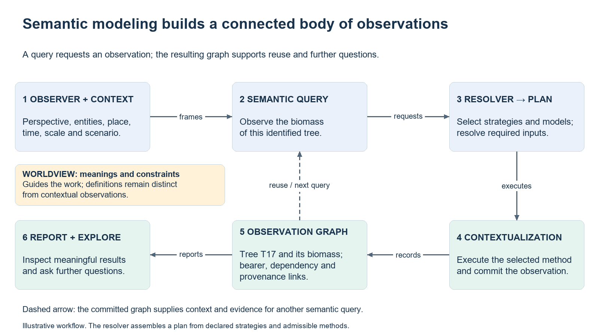
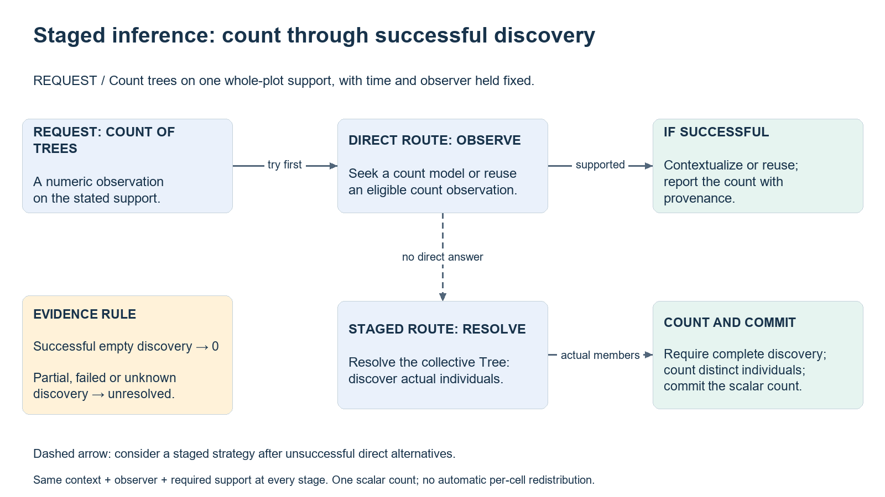
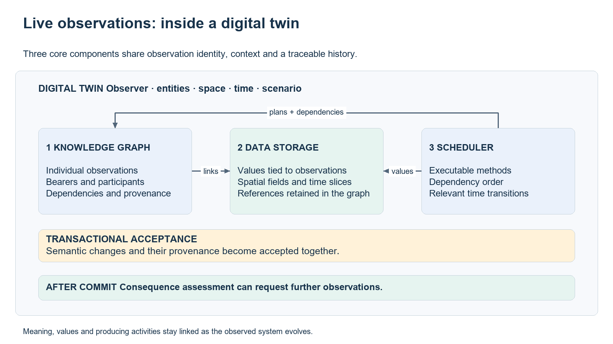
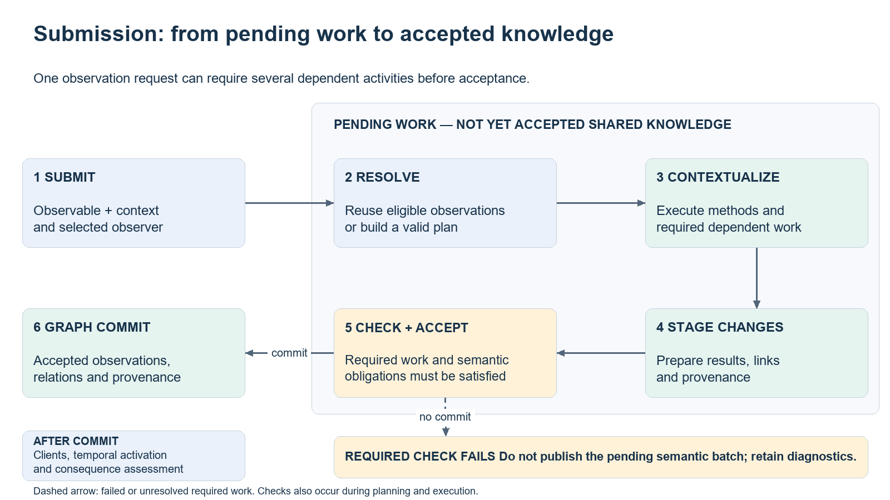
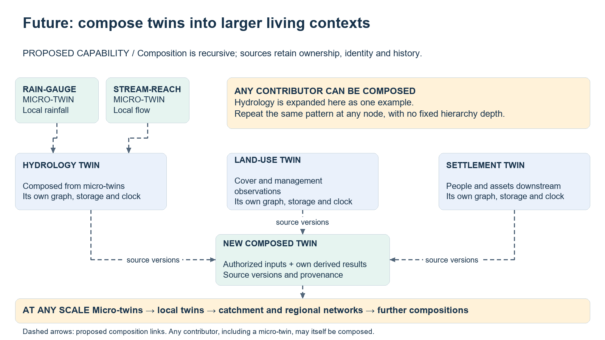

# A semantic commons for meaningful computation

Presentation material · working draft · revised 5 November 2026

## Editorial brief

Audience: an intelligent, ontologically competent community exploring computable
semantics, without assumed knowledge of a particular platform or of software development.
The subject is the approach and the shared knowledge it makes possible. Infrastructure
names belong in source notes, not in the slide narrative.

The opening four slides introduce the rationale, context and semantic cycle. Slides 5–17
develop **specifying computable semantics**: the ODO-IM contract, linguistic composition,
semantic modeling, contextualization and staged resolution. Slides 18–26 introduce
**the worldview**: composable ontologies, integrity and inference clauses,
infix and prefix operators, consequence clauses and value operators. Slides 27–35 develop **authorities**:
the identity contract, filtering and reconciliation, two kinds of deferred analysis,
and examples of reusing community classifications. LAND receives three slides: its
semantic mediation purpose, the comparison mechanism, and initial source-entry adoption.
Slides 36–42 describe **live observations in digital twins**: the three components,
models, individual identity, submission, transactions, consequences and future composition.
Slides 43–45 introduce **behavioral agency with k.Actors**: agent-bound behavior, an
illustrative response cycle, and applications including digital-twin web interfaces.
Slide 46 closes with the semantic-commons proposition and its requirement for a
collaboratively developed, broadly community-owned worldview.

For Slides: use **On-slide copy** as visible text and **Speaker notes** as narration.
Use the diagram as the main visual on slides 3–4, 11, 16, 36, 39 and 42; avoid repeating its contents in
additional text boxes. Source and editorial notes are not slides. Each diagram is a
native, editable Draw.io source; its PNG companion is a preview for placement.

## Slide 1 — Meaningful computation: semantics in context

### Takeaway

Shared meaning can guide the production of observations, as well as their interpretation.

### On-slide copy

**Ask for what should be known, in a stated context.**

- **Ontology makes meaning actionable:** distinguish entities, qualities, processes and
  relationships, and constrain what can be observed about them.
- **Context makes the request concrete:** where, when, at what scale, under which
  assumptions and from whose perspective?
- **Semantics guides computation:** find compatible evidence and methods, resolve their
  dependencies, and retrieve or compute an observation.
- **The result retains its meaning:** report it with context and provenance, and commit
  it to a digital twin where it can support further observations.

**A semantic commons shares meanings and observation methods so contributions can be
reused across questions, disciplines and institutions.**

### Speaker notes

“Computable semantics” means that formal meaning participates in deciding what to do.
An ontology supplies distinctions and constraints; observation methods connect those
distinctions to evidence and computation. Neither an ontology alone nor a collection
of annotated files supplies the scientific methods required to answer a question.

An observable specifies what could be observed. An observation realizes that meaning
for a particular context. A model supplies a method for doing so. The same request can
therefore use different evidence and methods in different places or periods without
changing what was requested. Compatibility is a condition of reuse, not an automatic
guarantee of scientific adequacy.

Observation includes identifying entities, measuring qualities, establishing relationships
and simulating processes. It need not be an instrumental measurement. Context includes
the entities being described and the applicable observer perspective as well as space
and time. Scale and assumptions matter to the interpretation of every result.

Reporting and digital-twin integration are two uses of the same meaningful observation.
A digital twin is a contextualized graph of observations and the activities that produced
them: a representation of a real or hypothesized system with a traceable history.
A map or number can be extracted for a report while retaining its link to that history.

The commons also needs shared stewardship of meanings, review of contributions and
respect for provider rights and attribution. Sharing terminology is a starting point;
sharing reusable, accountable ways to observe is the larger opportunity.

### Visual direction

Keep this slide typographic: emphasize **meaning + context → observation**.
Introduce the lifecycle diagram on slide 3, after the context slide.

## Slide 2 — Context: the frame that makes meaning actionable

### Takeaway

Context tells the resolver which observations and methods can answer this request.

### On-slide copy

**The same observable can call for different evidence and methods in different contexts.**

| Context dimension | Example question |
| --- | --- |
| Entities and relationships | Which watershed and hillslopes are we describing? |
| Space and time | Where, during which period, and with what spatial and temporal support? |
| Scenario and assumptions | Under which land-use scenario and scientific assumptions? |
| Observer | From whose explicitly represented perspective is the observation sought? |

**The observer is part of the context for resolution: perspective informs selection and reuse.**

### Speaker notes

Context is more than a bounding box and a date range. It includes the entities already
observed, the bearer of a quality, relevant relationships, the scenario and the observer.
Together these give a request its situated interpretation and constrain applicable evidence
and methods. Available resources and their access conditions also constrain what can be done.

The observer is a represented agent whose perspective is relevant to the observation.
It need not be the person operating the interface or the authenticated user. A watershed
manager and a farming community could be represented as different observers. Their perspectives
might matter to a subsequent valuation or assessment; selecting a different observer does
not by itself imply different physical erosion or authorize an incompatible model.

For resolution, distinguish a perspective explicitly required by the request from an
observer supplied by the surrounding context. The former constrains semantic compatibility;
the latter guides preference among compatible observations and methods, with perspective-neutral
fallback where allowed. Explain this verbally; no implementation syntax is needed on the slide.
An observer's perspective cannot override the other semantic or scientific validity conditions.

Continue with a fixed illustrative context: watershed W and its hillslopes; 2030; monthly
steps and 100 m spatial support; a stated land-use scenario; a represented watershed manager
as observer. These choices must accompany the results so that later reuse preserves their
interpretation. The example does not assume that this observer has a special erosion model.

## Slide 3 — From a question to an observation

### Takeaway

A semantic request becomes a contextual observation through an explicit chain of work.

### On-slide copy

**Example: observe soil erosion in watershed W during 2030.**

**The meaning stays explicit from submission to result; the method is selected for the context.**

### Diagram source

[Editable Draw.io diagram](diagrams/semantic-observation-cycle.drawio)

### Speaker notes

1. **Submission:** state the observable and its context. Our hypothetical request concerns
   a soil-erosion process in watershed W during 2030, under a specified land-use scenario,
   using a monthly time step and 100 m spatial support, with a represented watershed
   manager as observer.
2. **Resolution:** find compatible existing observations and applicable methods; establish
   what evidence they require. A candidate erosion method might depend on rainfall,
   terrain, soils and vegetation cover. Meaning, context, coverage and access conditions
   constrain selection. Existing suitable observations can be reused.
3. **Contextualization:** obtain the required observations and execute the selected method
   in the requested context. Any conversions or scale mediations must be justified by
   the method and its validity conditions. Here the process simulation supplies a
   spatially and temporally situated soil-loss estimate.
4. **Digital-twin commit:** record the resulting observations, their context, dependencies
   and the activities that produced them. This is a knowledge transaction, not a source-code
   commit. A report can use the committed results, for example an annual soil-loss map in
   t/ha/year, with the scenario, method and provenance stated.
5. **Consequences:** inspect committed observations for applicable semantic rules. These
   may attribute roles, detect configurations or request further observations. Follow-up
   requests return to ordinary resolution and contextualization; the next slide expands this.

The diagram is a conceptual cycle, not a promise of one method or one dataset per stage.
Dependent observations can require their own work. A request may remain unresolved when
compatible evidence or methods are unavailable; naming an observable does not create evidence.
An unsuccessful computation must not be presented as a completed scientific observation.

## Slide 4 — An observation can make further knowledge actionable

### Takeaway

Consequences connect committed meaning to further observation, while methods establish values.

### On-slide copy

**Continue the erosion example: what else becomes relevant?**

**A rule can make a new question actionable. Evidence and a method must still answer it.**

### Diagram source

[Editable Draw.io diagram](diagrams/semantic-consequences-example.drawio)

### Speaker notes

Assume that the community has explicitly defined and reviewed two illustrative rules:
an erosion process confers a sediment-source role on its affected hillslope; that role
implies a request to observe sediment export from that hillslope. These are teaching
assumptions, not claims about supplied ontology declarations or a tested model catalogue.

After an erosion observation commits, the first rule can attribute the role. The second
can initiate a new request. The role attribution does not itself compute an export value.
Resolution must find an applicable method and its dependencies, such as transport and
retention information. Contextualization then computes the export observation, if possible,
and a subsequent commit adds it to the twin with its own provenance.

Eroded soil and exported sediment are distinct observations: some material may be retained
before leaving the hillslope. Nothing in the role attribution proves a quantity or that
sediment reaches a river. The scientific relationship must be supplied by the selected
method, including its assumptions and support.

The result can now inform a sediment-budget report or a further twin query. Further
consequences may follow where rules and evidence support them. Missing methods leave the
follow-up unresolved; they do not turn a semantic implication into a fabricated value.
The arrows express observation dependencies, not a physical claim that computation causes
erosion or sediment movement. Re-evaluating consequences does not require repeating
already satisfied work; no claim of unrestricted automatic closure is intended.

## Slide 5 — Specifying computable semantics: the ODO-IM contract

### Takeaway

A shared observational contract connects meanings to the activities that realize them.

### On-slide copy

| ODO-IM category | Its question | Example |
| --- | --- | --- |
| **Observable** | What could be observed? | A tree; its biomass; a pollination process |
| **Predicate** | What qualifies that meaning? | Eucalyptus; deciduous; pollinator |
| **Description** | What kind of plan can realize it? | Instantiation; measurement; simulation |

**Contextualization realizes the plan; an observation is the meaningful result in context.**

### Speaker notes

ODO-IM is the Ontology of Descriptions and Observations for Integrated Modelling.
Its contract organizes scientific observation, including entities, qualities, processes
and relationships. It does not restrict observation to direct measurement or numerical output.

Descriptions supply plans for contextualization. The operational activity categories
called contextualizations in the reference implementation correspond to these descriptive
commitments. Strictly, a Description is a plan, while the contextualization that carries
it out is an activity; provenance distinguishes plan, activity, observer and result.
A model supplies a particular method for fulfilling the activity required by the meaning.

A predicate refines meaning; it is not normally an independently observable thing.
“Pollinator insect” qualifies an insect, while a request to establish that role calls
for a corresponding observational activity. The following slides separate these dimensions.

## Slide 6 — Observable kinds: perspective × arity of dependence

### Takeaway

Observable categories follow a small matrix of observational perspective and dependence.

### On-slide copy

| Arity of dependence | Structural / continuant-like perspective | Functional / occurrent-like perspective |
| --- | --- | --- |
| **0 — independent observational focus** | **Subject**, including agents: a tree, a watershed | **Event**: an individual flood episode |
| **1 — dependent on a bearer** | **Quality**: biomass of a tree | **Process**: erosion of a hillslope |
| **2 — dependent on participants** | **Structural relationship**: a connection between entities | **Functional relationship**: an interaction between entities |

**Arity counts dependence, not the number of observations returned.**

### Speaker notes

Read this as ODO-IM's observational matrix, rather than a replacement for a foundational
ontology's account of continuants and occurrents. Structural and functional perspectives
are continuant-like and occurrent-like, respectively. Subjects and events can supply the
independent focus for an observation in their corresponding perspectives.

The unary row states native dependence on a bearer. It does not say that a quality or
process has only one scientific input, that processes can only inhere to events, or that
other dependencies disappear. The current language supports quality and process inherency
under its type and applicability constraints; older explanatory prose does not add restrictions.

Relationship nature is structural or functional. Independently, orientation can be directed,
with ordered source and target, or a bond, with unordered participants. A functional
relationship here is not an OWL functional property. Two participants do not imply two outputs.

Configurations describe recognized patterns emerging from other observations. Their
emergence and detection contract is introduced separately; they are not an additional
arity row. “Agent” specializes the subject side with agency.

## Slide 7 — Predicates: identity, attribute and role

### Takeaway

Predicates express distinct reasons for qualifying an observable.

### On-slide copy

| Predicate | What it contributes | Illustrative reading |
| --- | --- | --- |
| **Identity** | A classificatory identity, often grounded in an established taxonomy | An **Eucalyptus** tree |
| **Attribute** | A characteristic, disposition, state or qualitative ordering | A **deciduous** tree |
| **Role** | A contingent function played in a context | An insect acting as a **pollinator** |

**One entity can carry several predicates without becoming several entities.**

### Speaker notes

An identity predicate expresses a classificatory commitment, such as a biological or
chemical identity. It is distinct from the unique identifier of an observation: several
trees can share a taxonomic identity while remaining distinct individuals. Authorities
can connect these commitments to established external classifications.

Attributes express descriptive distinctions; admissibility depends on the kind of
observable they qualify. Roles depend on the context in which an entity participates.
An insect need not play a pollinator role in every setting, and can play several roles.
Attributing a role does not change its biological identity.

The framework also includes realms, which constrain where a bearer belongs spatially or
conceptually, and domains, which organize knowledge. These are not synonyms for the three
predicate kinds above. Community declarations establish applicability, compatibility and
identity requirements; linguistic plausibility alone does not establish admissibility.

## Slide 8 — Collective and singular: finding entities, then explaining them

### Takeaway

Discovery of individuals and explanation of one individual are different commitments.

### On-slide copy

| Request | What it asks for | Required activity |
| --- | --- | --- |
| **Each tree** in the selected context | Discover zero or more individual trees | Instantiation, then acknowledgement of each |
| **This tree**, already identified | Explain the individual as a tree | Acknowledgement |
| **Biomass of each tree** | Obtain the trees, then their biomass | Distributed measurement on their native bearers |
| **Count of trees** | One numeric observation on the requested support | Quantification |

**A successfully empty collection is evidence; unsuccessful discovery is not zero.**

### Speaker notes

Subjects, agents, events and relationships have individual identities. A collective
substantial request can discover zero or more members. A singular request concerns a
particular individual identified by its context and observation identity; the type name
alone does not select a specific real-world individual.

A cohort collects members sharing an observable. It is not one giant individual replacing
those members. Each member retains its identity and can bear its own observations.
The reference language uses `each` for collective/distributed forms, but the resulting
activity depends on the effective head: `each Tree`, `Biomass of each Tree` and
`Species of each Tree` have different obligations.

Acknowledgement commits to or explains an individual. It need not produce numbers; a
legitimately identified substantial can be acknowledged without an explanatory model.
Connection discovers relationships and likewise requires acknowledgement of individuals.
Neither an unresolved collection nor a failed explanatory computation proves emptiness.

## Slide 9 — A linguistic framework: compose meanings along clear dimensions

### Takeaway

A small set of semantic dimensions can express many scientifically useful observables.

### On-slide copy

| Dimension | Illustrative expression | Reading |
| --- | --- | --- |
| Head observable | `biology:Tree` | A tree |
| Identity qualification | `biology:Eucalyptus biology:Tree` | An Eucalyptus tree |
| Attribute qualification | `ecology:AboveGround ecology:Biomass` | Above-ground biomass |
| Native bearer | `ecology:Biomass of biology:Tree` | Biomass belonging to a tree |
| Distribution | `ecology:Biomass of each biology:Tree` | Biomass for each tree |
| Semantic derivation | `probability of hydrology:FloodEvent` | A probability, rather than a flood episode |

**Reusable dimensions reduce the need to coin a new atomic term for every question.**

### Speaker notes

Namespace prefixes identify the vocabulary supplying each concept. The surface form is
linguistic, but the expression is a structured specification, not unrestricted English.
Predicate applicability and relationships between concepts determine admissible compositions.

For example, `(ecology:AboveGround ecology:Biomass) of each biology:Tree` composes an
attribute, a quality, its bearer and distribution. It does not require a separate atomic
term for every possible kind of biomass on every possible bearer.

This reduces terminology by separating reusable dimensions. It does not eliminate domain
concepts, scientific judgment or stewardship. Grouping matters: a predicate on an operator's
operand can mean something different from one on the derived quality. Examples assume
compatible worldview declarations.

## Slide 10 — Express meaning once; supply context and method separately

### Takeaway

An observable need not encode the place of execution or prescribe its algorithm.

### On-slide copy

**Meaning:** `ecology:Biomass of each biology:Tree`

| Supplied separately | Illustrative choice |
| --- | --- |
| **Context A** | Forest plot A, 2030, individual-tree support, observer A |
| **Context B** | Forest plot B, 2035, individual-tree support, observer B |
| **Possible method** | Compatible inventory observations, or an applicable allometric model |

**The requested meaning remains stable; evidence and methods must fit each context.**

### Speaker notes

`of Tree` specifies the native bearer of biomass. It is part of the meaning, not a
substitute for selecting actual trees, location, period and support. Context supplies
those bindings.

A method may use existing observations, data-backed models or computational models with
dependencies. Different methods can realize the same meaning where scientific validity
and contextual coverage hold. The expression supplies neither a dataset identifier nor
a regression equation.

Separation does not prohibit semantic qualifications about time, causation or perspective
when they change the intended meaning. An explicit observer clause constrains compatibility
differently from an observer supplied only by context. A request need not spell out all
context, and method selection must preserve every qualification it does state.

## Slide 11 — Semantic modeling builds a connected body of observations

### Takeaway

Queries request observations; contextualization adds their results and relationships to a graph.

### On-slide copy

**The knowledge graph becomes the context and evidence for further questions.**

### Diagram source

[Editable Draw.io diagram](diagrams/semantic-modeling-workflow.drawio)

### Speaker notes

An observer works within a context containing a knowledge graph. A semantic query submits
an unresolved observation: an intention to realize a specified meaning in that context,
rather than merely to retrieve graph statements.

The resolver selects and instantiates applicable observation strategies, finds admissible
models and assembles a contextualization plan. “Creates strategies” here means constructing
the strategy-based plan for this request, not inventing unconstrained scientific methods.
Execution contextualizes the requested observation and necessary dependencies.

Committed observations join the graph with links for bearers, participants, dependencies
and provenance. A tree's biomass is attached to that tree; they do not collapse into one
node. The worldview defines meanings and constraints; the twin graph records contextual
instances. These are related but distinct graphs.

The graph can answer later queries by reuse, or supply context and inputs for new work.
Reports expose selected results with meaning and history. The diagram shows semantic
modeling; ordinary graph lookup remains a useful separate operation.

## Slide 12 — Contextualization I: entities, connections and occurrences

### Takeaway

The observable's meaning determines what kind of observational work must occur.

### On-slide copy

| Meaning requested | Contextualization | What counts as the result |
| --- | --- | --- |
| Trees or flood episodes, collectively | **Instantiation → acknowledgement** | Identified individuals, each acknowledged |
| One identified tree or flood episode | **Acknowledgement** | The individual explained in its context |
| Connections between entities | **Connection → acknowledgement** | Identified relationships and their participants |
| A soil-erosion process | **Simulation** | A contextualized process whose execution follows time |
| A configuration recognized from ingredients | **Detection** | The emergent configuration observation |

**An observation may establish existence, structure or dynamics; it need not be a number.**

### Speaker notes

The semantic activity is determined before a particular scientific method is chosen.
Methods must fulfill that activity's obligations; contextualization is more specific
than a generic instruction to run a model.

Instantiation and connection can return zero or more individuals and trigger their
acknowledgement. A bounded event is an individual occurrence with temporal identity;
finding flood episodes differs from simulating an ongoing process. An event's execution
follows its temporal boundaries after identification.

A process is resolved as a simulation and participates in the twin's time evolution.
A configuration becomes observable through detection of emergence from ingredients.
A model can subsequently explain a detected configuration; it does not instantiate one
merely by declaring an output. Discovery, explanation and temporal execution are distinct.

## Slide 13 — Contextualization II: assigning different kinds of values

### Takeaway

A value's semantics determine the activity, representation and valid interpretation.

### On-slide copy

| Observable | Contextualization | Result commitment |
| --- | --- | --- |
| Air temperature | **Measurement** | Physical quantity with a unit |
| Tree count or flood probability | **Quantification** | Number with its appropriate interpretation |
| Property value or stakeholder preference value | **Valuation** | Monetary currency or a declared nonmonetary value scale |
| Type of tree | **Categorization** | A concept from the declared value space |
| Presence of trees | **Verification** | Boolean presence or absence on the observed support |

**25 °C, 25 trees and a preference rank of 25 are different observations.**

### Speaker notes

The implementation names the physical-quantity activity `MEASURE`; the slide uses its
ordinary-language noun. A count is not a measurement in a physical unit. Probability is
not a frequency count merely because both are numeric. Valuation introduces a value
scale and can depend strongly on perspective.

Categorization assigns a concept as a quality's value. Verification establishes presence
or absence within requested support. False requires evidence appropriate to that support,
just as zero does for a count; unavailable evidence is not false.

Retrieval, estimation and computation can supply values where methods satisfy the observable.
Aggregation needs an applicable method and support: assigning a regional value does not
justify copying it into every cell.

## Slide 14 — Contextualization III: attributing, explaining and transforming predicates

### Takeaway

Qualifying an entity, attributing a predicate and explaining it are different operations.

### On-slide copy

| Illustrative form | Activity | What changes or is explained |
| --- | --- | --- |
| `Deciduous Tree` | Requests a qualified tree | The requested entity must meet the qualification |
| `Species of each Tree` | **Classification** | Attribute a concrete identity to each discovered tree |
| `Deciduous of each Tree` | **Classification** | Attribute that concrete attribute where the method establishes it |
| `Deciduous of Tree` | **Characterization** | Explain the predicate within one identified tree |
| A compatible rescaling predicate on a quality | **Transformation** | Transform the quality as the predicate specifies |

**Classification → characterization: attribution and explanation have separate commitments.**

### Speaker notes

These are schematic forms: Species and Deciduous must be appropriate predicates and Tree
a substantial. `P Tree` qualifies the tree requested; `P of Tree` asks for work about
the predicate within a tree. Word order is part of the contract.

Distributed substantial inherence selects classification; individual substantial inherence
selects characterization, independently of predicate abstractness. A classifier must
establish a concrete predicate, either the requested predicate itself if concrete or an
admissible specialization. It cannot attribute an abstract root.

A newly attributed predicate is then characterized in the individual's scope. A valid
attribution can remain when no explanatory model exists; failure of a method that actually
executes is a different outcome. Classification enriches the same individual's semantics.

`type of Tree` instead asks for a categorical quality whose value is a concept. It is not
interchangeable with attributing a predicate. A predicate inherent to a quality selects
transformation; a bare predicate without an admissible bearer produces no observation.
Head kind and inherency therefore matter together.

## Slide 15 — OBSERVE and RESOLVE: two levels of finding a method

### Takeaway

A strategy can use direct model lookup or recursively resolve another meaning.

### On-slide copy

| Operation inside a strategy | What it asks the resolver to do | Obligations |
| --- | --- | --- |
| **OBSERVE X** | Find an admissible model for the complete observable X | Resolve model dependencies and cover the required context |
| **RESOLVE X** | Seek applicable observation strategies for X | Construct a valid route, possibly in stages, covering the required context |

**A model is a method; a strategy organizes methods and observations to fulfill a request.**

### Speaker notes

The capitalized words are planning operations, not mutually exclusive user interfaces.
At the user level, “observe X” can submit a request entering the full resolution process.
Inside a strategy, OBSERVE performs model lookup for its target; RESOLVE opens strategy
selection recursively for that target. Model dependencies still undergo resolution when
the model was found through OBSERVE.

Direct whole-observable strategies are normally attempted first. Later strategies can
analyze meaning, resolve prerequisites and compose staged work. Configurable matching,
conditions and ranks determine applicability and alternative order; model ranking is a
separate choice. Strategy order is not a scientific causal law.

Both routes must fulfill the requested context and support, including bearer, time, scale,
perspective and mandatory dependencies. Geographical overlap is insufficient. A plan that
finds temperature somewhere cannot stand in for biomass of the requested trees.

“Resolution” is overloaded: ODO-IM also uses it for a family of explanatory Descriptions.
Here RESOLVE denotes recursive planning. Planning success does not prove execution.
Complementary coverage is a contract to preserve; this presentation does not claim
unrestricted combination of partial plans in the current runtime.

## Slide 16 — Staged inference: answer a count through successful discovery

### Takeaway

When no direct method answers the whole observable, a strategy can proceed in stages.

### On-slide copy

**No direct count model → discover trees → establish complete support → count distinct members.**

### Diagram source

[Editable Draw.io diagram](diagrams/staged-observation-resolution.drawio)

### Speaker notes

Ask for a tree count on one explicitly defined whole-plot support, with observer and temporal
reference fixed. First try a compatible direct model or reusable count observation. The
staged route is considered after applicable direct alternatives are unsuccessful; a failure
retains its diagnostic and is never reinterpreted as a successful zero.

A strategy recognizes the count operator and operand, RESOLVEs the collective tree
observable, and applies a counting operation to actual discovered members. Tree discovery
can itself use strategies and models. Count member identities, not planning nodes or models.

Successful discovery covering the requested support permits a count, including zero for
no members. Partial, unknown, failed or cancelled discovery cannot prove zero. Context,
observer selection and support survive every stage. This example produces one whole-support
scalar; it does not imply automatic counts per grid cell.

This is configurable procedural inference guided by semantics, not discovery or counting
performed by OWL alone. More complex strategies can organize classification, transformations,
filters and dependent observations under declared contracts. General operators and arbitrary
context changes have different implementation maturity; the bounded count/presence route
has focused verification rather than general live-stack acceptance.

## Slide 17 — Configurable inference: a filtered observation in stages

### Takeaway

A strategy can unpack a compound question into discoveries, dependent observations and selection.

### On-slide copy

**Question:** `each biology:Tree whose ecology:Biomass > 100.kg`

| Stage | Observational commitment |
| --- | --- |
| **Try the complete question** | Use an admissible direct method if one covers it |
| **Discover the candidates** | Resolve trees within the requested context |
| **Resolve the dependent quality** | Obtain biomass on each individual tree |
| **Apply the condition** | Compare compatible quantities; retain qualifying individuals |
| **Return the observation** | Preserve individual identities, support and provenance |

**Configure the strategy and the 100 kg threshold; keep the observational commitments explicit.**

### Speaker notes

This is a conceptual strategy example, not a claim that a general `whose` strategy is
implemented. Its purpose is to show how a compound observable can remain actionable
without a bespoke model for every complete expression. Matching extracts the bearer,
dependent quality and threshold; declared strategy conditions and ranks govern the
eligible route. Each dependent observation can itself require staged resolution.

The strategy does not replace the biomass method with logic. It organizes the questions
that scientific methods must answer, then applies the specified selection. Biomass belongs
to each actual tree; regional biomass or a value from a different tree cannot silently
substitute. Compatible units are required at the comparison step.

Missing biomass cannot be treated as below threshold. A claim that all qualifying trees
were found requires complete candidate discovery and adequate evidence for every required
comparison. If the support is only partly resolved, that limit must remain explicit rather
than being reported as a complete filtered observation.

This is the broader configurable-inference pattern behind staged resolution: semantic
composition supplies a question structure, strategies arrange the work, and methods
establish the observations used by the inference.

## Slide 18 — The worldview: composable, OWL-compatible ontologies

### Takeaway

A worldview supplies the shared semantic commitments that make composition coherent.

### On-slide copy

- **A set of coordinated ontologies:** shared observational foundations and domain concepts.
- **OWL-compatible definitions:** specialization, equivalence, restrictions and logical combinations.
- **Designed for composition:** reusable heads, predicates, bearers, participants and operators.
- **Operational clauses:** constrain legal meanings and identify applicable inferences and consequences.
- **Community stewardship:** definitions, boundaries and revisions require accountable review.

**The worldview defines meanings; the observation graph records their realizations in context.**

### Speaker notes

A worldview is not an enumeration of every compound query. Concepts and constraints allow
compatible meanings to be composed. Domain ontologies can remain modular while sharing
the observational contract. External authorities contribute identities without copying
entire classifications into one ontology.

The worldview language offers readable declarations aligned with OWL and the observation
framework. OWL compatibility does not mean every operational clause is an ordinary OWL
entailment or executes within an OWL reasoner. Runtime activities, scientific execution,
provenance and consequences have explicit additional contracts.

Keep ontology classes distinct from individual observations in a twin. A Tree concept is
reused across contexts; a tree observation has its own identity, geometry and history.
Methods are supplied separately and refer to the same observable language.

## Slide 19 — Worldview clauses I: integrity and inference

### Takeaway

Some clauses constrain admissibility; others establish reusable semantic relationships.

### On-slide copy

| Clause family | Illustrative commitment | Why it matters |
| --- | --- | --- |
| **Integrity: applicability** | WaterSupplier `applies to` reservoirs or utilities | Restrict eligible bearers |
| **Integrity: identity** | Height `requires identity` Areal or Volumetric on its bearer | Require the complete identity obligation |
| **Integrity: endpoints** | DrainsTo `links` regions `to` water bodies | Constrain participants |
| **Inference: taxonomy** | Runoff `is` WaterFlow; genuine aliases use `equals` | Infer specialization or equivalence |
| **Inference: descriptive links** | FloodSeverity `discretizes` FloodDepth | Relate a classification to its described quality |

**A declaration licenses meaning; a scientific method still supplies the observation.**

### Speaker notes

These groupings explain purpose; they are not disjoint OWL syntactic categories.
Restrictions participate in reasoning as well as validation. Inheritance and Boolean
structure matter: one convenient fragment cannot discharge a complete inherited obligation.

For qualities and processes, an identity requirement concerns the effective bearer under
the declared contract. Explicit abstractness is separate. Current `requires` forms include
identity and realm requirements; the removed `requires attribute` and `requires extent`
forms should not be introduced.

The next slide expands predicate commitments, descriptive links, qualitative dependence
and process-effect contracts, which deserve explicit treatment before the infix operators.

## Slide 20 — Semantic contracts: qualification, description and effects

### Takeaway

The worldview can state what qualifies an observable, what describes it and what can change it.

### On-slide copy

| Clause | Semantic commitment |
| --- | --- |
| `inherits` | Attach predicate commitments; use `is` separately for taxonomic parentage |
| `describes` | Relate a descriptive observable to what it describes, optionally with a value constraint |
| `marks` | Associate a deniable marker with a nonzero or satisfied quality |
| `classifies` | Relate a classification to the quality it classifies |
| `increases with` / `decreases with` | Express direct or inverse qualitative dependence |
| `creates` | Declare observables that may be produced |
| `affects` | Declare observables whose state may be modified |

**These contracts guide interpretation and inference. Methods supply the computation.**

### Speaker notes

`inherits` supplies predicate-like commitments rather than an alternative spelling of
subclassing. The guide's schematic Snow identity inherits Solid and Frozen predicates;
its taxonomic parents would be stated separately using `is`.

Description clauses establish different kinds of semantic connection. `describes` can
include a numeric range, concept or Boolean constraint. `marks` identifies a deniable
marker of a quality; it is not a display label. `classifies` relates a classification
to a quality, while `discretizes`, illustrated on the preceding slide, adds ordering or
discretization of a quantitative quality. Declaring these links is distinct from executing
classification or measuring a value in a particular observation.

`increases with` and `decreases with` express qualitative proportionality. They supply
neither a numerical equation nor coefficients, and do not themselves establish a causal
mechanism. Type compatibility and the applicable inference rules still have to hold.

The guide's examples distinguish Precipitation creating WaterVolume from Heating affecting
AtmosphericTemperature. These declare semantic potential; a model must provide the
scientific computation. Passive `created by` and `affected by` forms express the same
source-to-target relationships when declared on the target. They do not introduce a
different causal direction.

Effects and inherency remain independent: a process affecting a region's temperature
does not become that temperature's native bearer. Nor does an effect clause waive identity,
context, support or evidence requirements. These contracts make contributions interpretable
and constrain suitable work without pretending that ontology declarations perform it.

## Slide 21 — Inherency: `of` determines the native bearer

### Takeaway

Contextualization must preserve what a quality or process belongs to.

### On-slide copy

**`Biomass of Tree`: observe the tree's biomass, even when working within a forest or region.**

| Effective head | Meaning of binary `of` | Illustrative request |
| --- | --- | --- |
| **Quality or process** | Native inherency: identify its bearer | `Biomass of Tree`; `Erosion of Region` |
| **Predicate** | Applicability: identify what is classified or characterized | `Species of each Tree` |
| **Configuration** | Emergence: identify its ingredients | `Network of Connection` |

**`of each Tree` distributes work over trees; it does not transfer biomass to their container.**

### Speaker notes

These are schematic names and compositions, assuming compatible worldview declarations.
The effective head determines how binary `of` is interpreted, including after aliases or
prefix derivations have been resolved. In the native-inherency case, the bearer is part
of the observable meaning. Choosing a larger query context cannot silently replace it.

`Biomass of each Tree` requires observations on actual individual trees. A regional total
or field is not the same observation and requires its own justified aggregation or mapping.
Processes also have native bearers under their declared constraints. Dependency inputs,
causal influences and the place from which data were obtained are separate relationships.

For predicates, distributed substantial applicability selects classification and individual
applicability selects characterization; applicability to a quality selects transformation.
For configurations, `of` expresses emergence, not native inherency. The application target
of a configuration is declared separately using `applies to`.

Independent subject, agent and event heads cannot acquire a native bearer through binary
`of`: `Tree of Region` is invalid. Unary operators such as `count of Tree` and `presence of
Tree` derive new qualities and are not this binary operator. The next slides separate
containment and other semantic relationships from these native commitments.

## Slide 22 — Containment: `within` does not replace `of`

### Takeaway

An observational container can make a request admissible while preserving its native bearer.

### On-slide copy

**Example: observe a stream's gradient while working in a regional context.**

| Commitment | What it establishes |
| --- | --- |
| `StreambedGradient of Stream` | The quality belongs to a stream |
| `Region contains Stream` | A declared observational container/type relationship |
| `Stream is Watercourse within Region` | Worldview shorthand for the containment contract, retaining parentage |

**Containment permits an observational route; it does not create streams, move their qualities or prove coverage.**

### Speaker notes

The names above are schematic. `Region contains Stream` and `Stream contained into Region`
declare the same additive observational contract. Worldview `Child is Parent within
Container` is shorthand for that container-to-child contract, while retaining the child's
specialization of Parent. It does not declare native inherency.

Observational containment is distinct from polygon enclosure, physical parthood, realm
membership and generic computation context. It does not assert that members exist, impose
an exhaustive list of member types or license arbitrary transitive containment. Successful
discovery can produce an empty collection; failed or unresolved discovery cannot prove emptiness.

The documented bounded route allows an independent precomputed stream-gradient model to
answer a request made in a declared Region container while retaining Stream as the native
bearer. It does not prove that streams were discovered, that a regional field was sampled
onto them or that their gradients cover the region. Recursive discovery, per-member binding
and redistribution each require their own supported strategy and scientific method.

Syntax depends on the host language: `within` is not a clause in a standalone observable
statement. Hosts can admit contextualized expressions, and the worldview declaration has
the explicit shorthand described here. Runtime scope selection is another operation.
Do not present `Quality within Subject` as a replacement for `Quality of Subject`, or
confuse the declaration with the separate `contained in` / `containing` expression modifiers.

## Slide 23 — Other infix clauses: make semantic relationships explicit

### Takeaway

Infix clauses qualify a meaning through declared relations to other meanings.

### On-slide copy

| Clause | Description |
| --- | --- |
| `causing X` / `caused by X` | Causal direction: what causes or is caused by X |
| `for X` | Goal or beneficiary |
| `adjacent to X` | Adjacency to X |
| `with X` | Compresence with X |
| `during X` | Temporal co-occurrence with X |
| `contained in X` / `containing X` | Containment qualification within the observable expression |
| `and X` / `or X` | Intersection or union of meanings |

**A semantic relationship constrains the question; it does not itself provide a computation.**

### Speaker notes

These clauses belong to the shared concept-expression language. The table omits namespace
prefixes for readability; for example, the documented expression
`hydrology:WaterFlow caused by climate:Precipitation` qualifies the flow's meaning rather
than prescribing a rainfall-runoff algorithm. The operands must satisfy the worldview's
type and relationship constraints.

Other documented readings include habitat suitability for a species, a road adjacent to
a river, a flood event during an annual period and a tree contained in a forest.

Several modifiers allow `each` on the related operand. Distribution and grouping remain
significant: use parentheses to make scope explicit. Composing a legally parsed expression
does not establish its semantic consistency, data availability or an executable strategy.
In particular, an `or` expression is not a guarantee that all alternative computations exist.

The expression modifiers `contained in` and `containing` are distinct from worldview
`contains` / `contained into` declarations and their `within` shorthand. Their presence
does not silently create a declared observational permission, a native bearer or coverage.

Relationship observables can additionally specify participants using `linking Source to
Target`. Observer perspective can be stated using the observable's `observed as` clause;
it is a statement qualification rather than one of the binary modifiers in this table.
These remain distinct from causal roles, native inherency and the context's selected observer.

## Slide 24 — Worldview expressions II: prefix operators change what is observed

### Takeaway

A semantic operator derives a new observable meaning from another concept.

### On-slide copy

| Base meaning | Derived expression | New observational question |
| --- | --- | --- |
| Tree | `presence of biology:Tree` | Are trees present on this support? |
| Tree | `count of biology:Tree` | How many trees are present? |
| Flood event | `probability of hydrology:FloodEvent` | What is the probability of the event? |
| Tree | `type of biology:Tree` | Which declared category describes it? |
| Air temperature | `change rate of climate:AirTemperature` | How fast is temperature changing? |
| Habitat suitability | `uncertainty of ecology:HabitatSuitability` | What uncertainty accompanies the observation? |

**Changing the effective head changes the required contextualization.**

### Speaker notes

Presence derives a boolean quality and verification; count derives a numeric quality
and quantification. A flood-probability request does not instantiate a flood episode.
`change rate of` differs from `change in`, whose occurrence semantics and obligations differ.

Operators belong to the shared concept-expression language and occur in worldview definitions
as well as queries. The worldview constrains operands and derived kinds. An expression
can be meaningful without an available method. Uncertainty requires a method and defined
interpretation, rather than a promise that every model supplies uncertainty automatically.

Prefix operators act on meaning. The value operators introduced later act on values,
conditions or selection within a meaning. Their distinction is operational.

## Slide 25 — Worldview clauses III: confers, implies, emerges from

### Takeaway

Consequence clauses make committed meaning relevant to further observations.

### On-slide copy

| Clause | Semantic commitment | Observation-cycle effect |
| --- | --- | --- |
| **confers** | A process or relationship confers a role on eligible participants | Attribute the role |
| **implies** | A role implies further observables; a configuration can imply participant roles | Request resolution or make the declared attribution |
| **emerges from** | A configuration emerges from a declared pattern of observations | Detect existence when the ingredients support it |

**Erosion → sediment-source role → export question. Connections → network detection → network explanation.**

### Speaker notes

The erosion chain recalls slide 4's hypothetical rules. Conferral can establish a role
without first finding a characterization model. Its implications can then request normal
resolution; they do not supply a computed export value. Applicability and recipient
selection still require justification.

Recognizing a network configuration from connections and explaining it scientifically
are separate steps. Detecting existence does not compute every network property. Models
explain configurations after emergence rather than instantiate them as ordinary collectives.

Consequences follow knowledge commits and can produce further commits. Preserve observer,
context and provenance through the cycle; reuse satisfied observations where valid.
Unsupported evidence and unavailable methods remain explicit. OWL declarations alone
do not establish execution or unrestricted termination and completeness.

## Slide 26 — Worldview expressions IV: value operators refine the question

### Takeaway

Value operators constrain, select or transform what an observation asks to report.

### On-slide copy

| Family | Example | Intended reading |
| --- | --- | --- |
| Comparison | `geography:Elevation > 500.m` | Compare elevation with a unit-bearing threshold |
| Bearer filter | `biology:Tree whose ecology:Biomass > 100.kg` | Select trees by biomass |
| Condition | `presence of biology:Tree when climate:PrecipitationVolume > 0.mm` | Condition the presence request on precipitation |
| Aggregation | `climate:AirTemperature averaged` | Request an appropriate average on stated support |
| Arithmetic transform | `statistics:Score times 100` | Rescale the requested score |

**`probability of FloodEvent` changes the observable; `> 0.7` adds a condition on its value.**

### Speaker notes

Value operators are inherited by the worldview's expression language, as are prefix
operators. Comparison operands must be compatible with the quantity or value type.
Filters such as `whose` introduce observations that may need resolution before selection.

Aggregation requires defined support and a scientifically appropriate operation.
Extensive and intensive quantities have different mediation behavior: summing volumes
and averaging temperatures are not interchangeable defaults. Arithmetic belongs in an
observable when the transform is part of the requested meaning; the scientific algorithm
used to produce it belongs in the method.

The examples explain semantic intent. Grammar support does not certify executable
strategies for every combination. A standalone observable need not express its execution
context, even though it can include semantic conditions relevant to that context. Complex
inference remains subject to the activity, coverage and evidence contracts already described.

## Slide 27 — Authorities: build on meanings communities already maintain

### Takeaway

Authorities bring established identities into a shared observational framework without
requiring communities to replace their classifications.

### On-slide copy

- **Reuse community work:** taxonomies, chemical registries, soil classifications,
  land-cover legends and statistical vocabularies.
- **Bind through identities:** an authority specializes a declared identity category;
  it does not introduce arbitrary observable kinds or methods.
- **Filter and reconcile:** select eligible usages, resolve ambiguity and retain a
  canonical identity with its source and edition.
- **Bring in what is needed:** resolve referenced identities and relevant ancestry;
  defer deeper analysis where the contract permits it.

**Adoption can start with a trusted community identifier, while preserving the community's distinctions.**

### Speaker notes

An authority is a configured bridge between an external terminology and a worldview
identity. The community remains responsible for its source concepts; the bridge is
responsible for admitting them under an explicit observational contract. This avoids
asking every scientific community to adopt one new classification or maintain a duplicate.

Identity is the point of attachment. A taxonomic identity can qualify an organism; a
chemical identity can qualify the substance being observed. The authority does not thereby
supply a population model, concentration measurement or classification of new specimens.
An external vocabulary's roles and relations do not automatically become operational
roles, causal rules or arbitrary observable heads in the worldview.

The bridge selects its source, edition or release, identity anchor and supported options.
A local authority name is a worldview choice, not a global renaming of the community's
registry. Reproducibility depends on retaining that configuration and source provenance
as well as the code. The five providers below illustrate different source structures;
their search filters, reconciliation rules and deferral capabilities are not identical.

## Slide 28 — Admit an identity now; expand its meaning when justified

### Takeaway

Finding a label, establishing an identity and completing its semantic analysis are separate steps.

### On-slide copy

| Step | Contract |
| --- | --- |
| **Filter** | Restrict search to relevant ranks or catalogs; preserve the configured source scope |
| **Reconcile** | Use codes, exact names and disambiguating fields to establish one canonical identity |
| **Anchor** | Attach the identity to a declared worldview category using provider-validated membership |
| **Analyze as needed** | Expand external ancestry or interpret a complex class under explicit rules |

**A search filter is not proof of category membership. Deferred analysis is not completed analysis.**

### Speaker notes

Search offers candidates. Reconciliation determines what a supplied designation denotes;
it must not choose the first candidate merely because it is highly ranked. Ambiguous,
invalid and unavailable results remain explicit. Filtering also governs admissibility:
synonym treatment, source membership and which external relations can become parent edges.

There are two distinct kinds of deferral. First, TAXA, PubChem and UN can attest a
reconciled identity's membership in a configured semantic boundary, such as Species,
Compound or a supported country category. The bridge attaches that identity to mapped
worldview identity categories while marking external ancestry as deferred. A search rank
or catalog name alone cannot establish membership. A later full-hierarchy request validates
and enriches the same identity; deferred does not mean parentless or fully analyzed.

Second, LAND can retain a precise source-entry identity even while its optional semantic
interpretation is absent or draft. Its meaning is not silently equated to an incomplete
translation. These are independent contracts: LAND does not advertise the deferred-ancestry
boundary mechanism, and WRB supplies its inexpensive group ancestry directly.

For complex expressions, a provider can also perform supported, directional identity
comparisons without enumerating every possible subclass in OWL. It must distinguish
compatible, incompatible, unknown and unsupported relationships. Similarity alone cannot
prove that a candidate meets a requested meaning. Other observable and context constraints
still apply even when an identity comparison succeeds.

## Slide 29 — TAXA: reuse a community taxonomy without losing its identity policy

### Takeaway

Scientific names become usable identities through an explicit taxonomic release and reconciliation.

### On-slide copy

**Community source: a pinned Catalogue of Life Extended Release in ChecklistBank.**

| Example | What the authority contributes |
| --- | --- |
| Search “white shark”, restricted to species | Candidate accepted identities for selection, not an automatic name assignment |
| Reconcile `Oenanthe` with `Plantae` and authorship `L.` | Disambiguating fields for a scientific-name match in the chosen release |
| A synonym of an accepted taxon | The same canonical identity as the accepted usage |

**A species identity can qualify an organism; it does not assert that the organism is present.**

### Speaker notes

The TAXA provider uses accepted and provisionally accepted usages from a pinned Catalogue
of Life Extended Release. It rejects bare or unplaced names, ambiguous synonyms and
misapplied names as identities. Scientific and vernacular searches can remain ambiguous;
scientific-name reconciliation uses explicit hints and accepted match types. The examples
above are documented interaction shapes, not a claim of a fresh public-service lookup.

Taxon codes are scoped to a dataset. The identity therefore includes the pinned release
and accepted taxon code; a new release does not silently replace the old identity.
Synonyms canonicalize to an accepted usage rather than becoming subclasses of it.
An identity predicate also remains distinct from an individual organism's identifier.

Species and genus are search filters on the same taxonomy, not independent vocabularies.
A species search can still require genus and family ancestors. If the worldview opts into
a Species boundary, the provider uses the accepted usage's actual rank after reconciliation,
not the search filter or synonym rank. It can defer external ancestry and later enrich
the same identity on demand.

This makes existing taxonomic expertise reusable while retaining source decisions and
release provenance. Discovering organisms, estimating abundance or observing ecological
roles still requires contextualization and scientific evidence.

## Slide 30 — PubChem and ChEBI: molecular identity and chemical families

### Takeaway

Chemical identifiers can be reconciled precisely without confusing a molecule with a broader family.

### On-slide copy

| Documented example | Identity interpretation |
| --- | --- |
| PubChem water `CID:962` | A molecular compound identity; local reference `CHEM:CID_962` |
| ChEBI water `CHEBI:15377` | Reconciles to `CID:962` after a unique, verified structure match |
| ChEBI hydrocarbons `CHEBI:24632` | A chemical-family identity, retained as `CHEM:CHEBI_24632` |

**Names find candidates; verified identity and structural relationships support reuse.**

### Speaker notes

PubChem supplies molecular compound records; ChEBI, accessed through OLS4, supplies
chemical ontology terms and structural superclass relationships. CHEM is an illustrative
worldview-local binding name. Canonical API identifiers retain their source namespace;
the local references use the grammar-safe spelling returned by the provider.

A molecular ChEBI term maps to a PubChem CID only after a unique InChI match and verification
against the returned compound. A family without such a molecular mapping remains a ChEBI
identity. A molecular formula or shared label cannot establish that two records denote
the same chemical entity. Exact name reconciliation must yield one canonical identity;
search suggestions are candidates, not identity proof.

Hierarchy filtering matters: structural parents can contribute superclass edges;
`has_role`, `part_of`, conjugate-acid/base and related links do not automatically do so.
An external term associated with a role does not thereby confer an observational role
on an entity in the twin.

With declared Compound or CHEBI boundaries, the provider can validate and anchor an identity
before reconstructing ancestry. Classification follows the reconciled identity: ChEBI water
mapped to a CID belongs to the Compound boundary even if found through a ChEBI search.
The identity can qualify a chemical observation; concentration, exposure and toxicity remain
separate observables requiring methods and context.

## Slide 31 — LAND: mediate meanings across independent classifications

### Takeaway

LAND's purpose is to compare what classifications mean across shared semantic dimensions,
while preserving their independent definitions.

### On-slide copy

**Express the definition, rather than reducing a class to its label or one superclass.**

| Semantic dimension | What an expression can make explicit |
| --- | --- |
| Composition and arrangement | Which components occur, and how they are organized |
| Quantities and support | Relative cover or phase duration; where and when criteria apply |
| Qualities and qualifications | Measured thresholds, identities, attributes, realms and roles |
| Dynamics and relations | Processes, events, relationships, alternatives and diagnostic groups |

**Different schemes → explicit definitions → shared semantic dimensions → reviewable mediation.**

### Speaker notes

LAND is intended as a bridge among independent land-cover and ecosystem classifications.
One scheme may emphasize vegetation composition; another may emphasize hydrology,
substrate, function or temporal regime. A common expression framework makes these
dimensions available for comparison without asserting that similar labels, regional
variants or overlapping ecological units are the same class.

The basic pattern language composes worldview configurations and identities. A schematic
example is `HorizontalArrangement(+++Crop, +NaturalVegetation)`: the configuration supplies
arrangement semantics, the arguments supply identities, and the marks express provisional
relative quantities under a declared measure and support. These shortened names are
presentation notation; the documented fixture uses qualified worldview references.
Unmarked components have unspecified shares, not equal shares.

Typed rules extend composition with participant-bound observable intervals, qualifications,
relationships, occurrence criteria and ALL/ANY/cardinality groups. For example, an invented
habitat rule can distinguish a soil participant's pH constraint from a canopy qualification
or a hydrological phase-duration profile. They must retain their bearers, units and support;
an advisory characteristic cannot silently become a defining requirement.

This offers a basis for conditional refinements and other reviewed relationships among
CORINE, IGBP, GET, EUNIS or national definitions. It does not flatten those schemes into
one asserted hierarchy. Required attributions and bindings are validated where supported;
unproved or unsupported relationships remain explicit obligations. Coexisting components
are not contradictory simply because their identities differ. A broad multidimensional
satisfiability proof or an official cross-classification mediation service is not thereby
implemented.

The compositional and mediation machinery has bounded implementations and experimental
fixtures. Current source-entry use cases do not yet exercise the full intended semantic
bridge. That adoption boundary should not obscure the reason LAND exists.

## Slide 32 — LAND mediation: overlap is evidence, not permission to substitute

### Takeaway

Mediation asks whether a candidate definition can fulfill a target under declared semantics and policy.

### On-slide copy

| Check | What must be established |
| --- | --- |
| **Semantic alignment** | Compatible structure, participants, criteria, measures and support |
| **Quantitative comparison** | Joint feasibility of relative quantities and directional containment |
| **Admission policy** | Proven entailment, or an explicitly chosen weaker operational rule |

**Invented example: crop : natural vegetation = 3:1 versus 4:1.**

With the documented relative-spread policy, they overlap, but neither entails the other.
The default policy admits neither as a substitute.

**Report the relationship, uncertainty and policy; preserve the original definitions.**

### Speaker notes

There are separate exact and fuzzy comparisons. Exact comparison establishes supported
structural equivalence or refinement using worldview semantics and explicit constraints.
Optional fuzzy mediation adds uncertainty to relative quantities under an immutable,
versioned policy for the authority binding. It is not approximate name matching.

For each marked quantity, a positive triangular distribution surrounds its central weight.
The solver compares increasingly restrictive uncertainty cuts. All marked components in
one configuration share a common scale: pairwise overlaps cannot be combined if they
require mutually inconsistent assignments. Possibility measures the highest cut at which
the relative-quantity constraints remain jointly feasible. Full directional containment
is checked across all cuts, rather than guessed from a similarity score.

The documented 3:1 versus 4:1 fixture uses relative spread 0.25 and overlap threshold 0.5.
Its quantitative possibility is approximately 0.713, yet neither definition entails the
other. Under the default PROVEN_ONLY policy it therefore supplies no admitted match.
The ratios are invented test definitions, not official CORINE percentages or calibrated
ecological thresholds. With relative spread, proportional weights such as 3:1 and 6:2
describe the same fuzzy ratio model.

An optional ALPHA_CUT policy is weaker: it requires the candidate's selected uncertainty
cut to be wholly contained in the target's corresponding cut, and a sufficient possibility
score. It reports operational admission separately from full entailment. It still does
not admit a candidate merely because the cuts intersect. Uncertainty spread, overlap
threshold and admission cut have different meanings; none may rewrite a source class's
defining threshold. Absolute observable intervals remain crisp.

Spatial area and temporal duration belong to separate scopes, with explicit interpretation,
support and reviewed independence assumptions. Unknown semantic direction, unsupported
aggregation or unresolved taxonomic coupling cannot be repaired by a numerical score.
The possibility result concerns this bounded relative-quantity subsystem, not every
dimension's joint satisfiability. Low overlap does not prove ecological incompatibility;
missing evidence returns UNKNOWN, not zero.

Supported admitted identity comparisons can inform ordinary semantic matching within a
configured binding. Comparing submitted definitions is distinct from automatically
mediating source catalogs or independently configured authorities. Reviewed cross-scheme
mappings, full scientific evidence integration and generated observation classifiers
remain further work. The intended outcome is an explainable bridge between independently
maintained meanings, without inventing equivalences or concealing contradictions.

## Slide 33 — LAND: source-entry matching as the initial adoption path

### Takeaway

Stable source-entry identities enable initial reuse while semantic interpretations mature.

### On-slide copy

**Example: IGBP classes in MODIS MCD12Q1 Collection 6.1.**

| Source entry | Configured codelist alias | Semantic discipline |
| --- | --- | --- |
| `6` — Closed shrublands | `land.igbp:ClosedShrubland` | Retain this exact source entry |
| `7` — Open shrublands | `land.igbp:OpenShrubland` | Retain a different source entry |
| Both translated provisionally as “shrub presence” | Same incomplete draft pattern | Does **not** make the two classes equivalent |

**Reuse the community's legend now; review its richer interpretation before authorizing mediation.**

### Speaker notes

The preceding slides describe LAND's semantic purpose. Source-entry matching is the initial
adoption path, rather than the reason for the authority's existence. A catalog-entry identity retains
catalog ID, pinned revision, source edition and exact source-code string. The readable
aliases above assume a configured codelist; the underlying identity is the source entry,
not the alias text and not its optional pattern.

The bundled IGBP translation is explicitly tentative testing material. The source classes
distinguish closed and open shrublands by cover thresholds. Its draft patterns omit those
thresholds and reduce both to shrub presence. That loss must not merge the source entries
or authorize a crosswalk. Verification of the source entry and review of its interpretation
are separate statuses. Missing observations or no-data codes are not cover identities.

Exact reconciliation can use source code or curated names, constrained by catalog, revision
and edition. Ambiguous names are rejected. Entry-only hosting supports annotation without
endorsing a pattern or requiring its proposed vocabulary. Explicit, validated source-class
inclusion can support entry hierarchy; shared labels or equal draft patterns cannot.

A separate, explicitly selected route supports validated compositional patterns and typed
rules, with provider-side comparison and declared mediation policies. This is useful for
semantics richer than a practical enumerated class tree, but it is not an automatic official
implementation of CORINE, IGBP, GET or EUNIS. No deferred-ancestry boundary is advertised.
Pattern/rule hosting needs explicit semantic integration; entry-only hosting is a distinct mode.

## Slide 34 — WRB: a structured soil name carries computable distinctions

### Takeaway

A naming authority can normalize a compositional standard and reason conservatively about its refinements.

### On-slide copy

**Community source: World Reference Base 2022, with corrections through September 2024.**

| Example | Canonical identity or matching interpretation |
| --- | --- |
| `Luvisol`, `Luvisols`, `lv` | `WRB:LV` |
| `Albic Stagnic Luvisol (Cutanic)` | `WRB:[LV-st.ab--ct]` |
| Requested Luvisol; candidate qualified Luvisol | Compatible refinement under the provider's rules |
| Requested Stagnic Luvisol; candidate generic Luvisol | Unknown: the generic name does not establish Stagnic |

**Resolve an existing soil classification; do not infer one from missing diagnostic evidence.**

### Speaker notes

WRB combines a Reference Soil Group with principal and supplementary qualifiers. The
provider works offline with the documented edition's vocabulary, codes and qualifier lists.
It validates naming syntax and supported constraints, normalizes eligible names and codes,
and preserves the source edition. It does not require enumeration of every qualifier
combination as a separate preloaded ontology class.

Comparison is directional: can this candidate supply the requested identity? A qualified
Luvisol supports a generic Luvisol request; an unqualified name cannot prove a qualifier.
Unknown is distinct from incompatibility. Supported qualifier inclusion and selected
refinements are provider judgments, not a numerical measure of pedological similarity.

For a soil map, local category 2 can be mapped to `WRB:[LV-st.ab--ct]`; category 2 itself
is not a WRB code. Preserve the original legend and edition in provenance. The closed
groups codelist provides the 32 generic Reference Soil Groups; it does not enumerate all
qualified names or accept invented groups. The provider supplies the inexpensive RSG
ancestry directly rather than using deferred-ancestry boundaries.

A valid name does not prove diagnostic horizons, laboratory measurements or complete
profile classification. Those remain the source classifier's scientific responsibility.

## Slide 35 — UN: reuse statistical classifications while preserving scope

### Takeaway

Statistical codes become interoperable identities only within their classification, edition and declared boundaries.

### On-slide copy

**Community sources: UN-endorsed classifications published through Caliper.**

| Example | What must be preserved |
| --- | --- |
| ICC 1.1 notation `1.06` — Rye | Canonical concept URI, classification and edition |
| M49 Spain | Select the explicit URI; a name or `724` alone can be ambiguous |
| M49 Europe versus a provider-attested country entry | Regional membership does not establish a Country identity |

**A shared label or a cross-classification link is not an identity equivalence.**

### Speaker notes

Each UN authority binding selects one SKOS ConceptScheme. Separate bindings can expose
crops (ICC), products (CPC), activities (ISIC), geographical codes (M49) and other catalogs.
These are independent configurations, unlike TAXA's rank search filters. An explicit edition
supports reproducibility; a latest alias selects its edition at configuration and can
select another edition after reload.

The documented Rye reference is
`UN.ICC:[https://stats.fao.org/classifications/ICC/v1.1/1-06]`.
The canonical identity is the published URI, not a label or inferred URI suffix. Notation
aliases work only when unique. Reconciliation combines exact name, notation, URI and
language constraints and must identify one concept. Shared labels, SKOS match links and
cross-edition correspondences do not automatically merge identities.

For Spain, the documented selected reference is
`UN.M49:[https://unstats.un.org/classifications/geo/M49/724]`.
The inspected dataset contains another Spain URI, so name or notation alone does not
justify choosing one. These are documentation examples, not refreshed endpoint findings.

The M49_COUNTRY boundary is provider-attested from Caliper's published self-governing
records; it is not a search filter or an independent assertion about sovereignty. It can
anchor qualifying entries to a declared Country identity while deferring ancestry.
Europe remains a geographical identity, not a Country through this mapping. Full ancestry
can be requested later. The provider also preserves necessary out-of-scheme ancestry as
support without admitting those ancestors as searchable members of the selected scheme.

## Slide 36 — Live observations: the digital twin

### Takeaway

A digital twin holds a system's meaningful observations, their data and the means to evolve them.

### On-slide copy

**One contextual system: knowledge graph + data storage + scheduler.**

### Diagram source

[Editable Draw.io diagram](diagrams/digital-twin-structure.drawio)

### Speaker notes

The knowledge graph records individual observations and their semantic relationships,
context, dependencies and provenance. Storage holds the values associated with observations,
including spatial fields and time slices. The scheduler coordinates executable observation
methods, dependencies and relevant time transitions. Values and execution remain tied to
the observations they describe.

An observer, focus, space, time and scenario frame the work. Models and contextualization
plans connect meaning to executable methods. A twin can represent a real or hypothesized
system; it need not be a real-time replica. “Live” means observations can participate in
further computation and change, rather than ending as disconnected outputs.

Transactions govern acceptance of observation changes. Consequences are assessed after a
successful commit; they are behavior associated with the twin, not a fourth core storage
component. Provenance is part of the graph, not a separate competing history.
Current persistence supports bounded restoration, not a general guarantee of autonomous
clock resumption or recovery of every interrupted activity.

## Slide 37 — Models: reusable methods for observing meaning

### Takeaway

A model declares what it can observe, what it needs and where its method is applicable.

### On-slide copy

| Model example | Meaningful inputs | Contribution to the twin |
| --- | --- | --- |
| A rainfall dataset exposed as a model | A compatible resource and requested support | A contextual rainfall observation |
| A tree-biomass model | Individual tree dimensions and a valid allometric method | Biomass attached to each actual tree |
| A runoff model | Rainfall, terrain and other declared dependencies | Runoff observations for the applicable context |

**Meaning + dependencies + applicability + method: the model can be reused beyond its original workflow.**

### Speaker notes

A model need not be a simulation. It can expose data, compute an expression, call a
scientific service or describe a dynamic process. Its output and dependency declarations
use observables; its method supplies the scientific work. The resolver can substitute
compatible sources for those dependencies where their contracts allow it.

The rainfall and runoff examples follow the modeling guide; the biomass example is
schematic. No equation or resource availability is asserted. A real allometric model
requires species applicability, valid measurement conventions and calibrated coefficients.
A runoff method must state the assumptions, units, support and dependencies its science
requires; naming rainfall and slope alone is not a universal hydrological model.

Selected methods and input observations become part of provenance. A successful catalog
search is not execution, and execution without required evidence is not a completed
scientific result. Models can update observations over time where the selected lifecycle
supports it; behavioral reactions and scheduling remain separate concerns.

## Slide 38 — Individuals are the anchors of the twin

### Takeaway

Observations about an individual must stay attached to that individual through change.

### On-slide copy

- **Tree T17 and tree T18 remain distinct**, even with the same species and dimensions.
- **Biomass belongs to a particular tree**, not just to an anonymous value or a class label.
- **New qualities and roles enrich the same individual**; they do not create replacement trees.
- **Relationships retain their actual participants**, and events retain their own temporal identities.

**Same meaning does not imply same individual. A changing state does not imply a new individual.**

### Speaker notes

Substantials—subjects, agents, bounded events and relationships—have individual identities.
A cohort groups individuals sharing an observable without merging them. An authority's
species identity classifies a tree; it is not the tree observation's unique identity.
Geographical overlap, equal values or identical semantic expressions likewise do not prove
that observations represent the same individual.

The graph links qualities to their native bearers and relationships to their participants.
If T17's biomass changes, its history must not be reassigned to T18. Attribution of a
pollinator role or classification of a tree enriches its semantics without changing the
individual concerned. A new flood episode is a new bounded event even if its event type
matches an earlier one.

This is essential to reuse, dependencies and consequences: a change matters because it
concerns a particular participant in a particular context. The same discipline applies to
future composition: observations retain their source identities rather than being merged
merely because their meanings or local numerical identifiers coincide.

## Slide 39 — Submission: from pending work to accepted knowledge

### Takeaway

Submission prepares and executes an observation; commitment makes its supported changes accepted.

### On-slide copy

**A requested observation is pending work. A committed observation becomes shared knowledge in the twin.**

### Diagram source

[Editable Draw.io diagram](diagrams/digital-twin-submission.drawio)

### Speaker notes

A submission identifies an observable and its context, including the selected observer.
The resolver can reuse eligible observations or build a plan from strategies and models.
Execution prepares the required dependencies, obtains values and stages new observations
or changes to existing ones. Supplied evidence is still subject to the relevant checks.

Before acceptance, meaning, actual inputs, bearer and participant identities, support,
permissions and execution outcomes must satisfy the operation's contract. A planned
candidate, assigned identifier or intermediate activity message does not prove completion.

The enclosing transaction commits the accepted graph changes and their provenance.
The graph retains links to the associated stored values; clients then consume the commit,
and applicable temporal activation and consequence assessment can follow. The diagram
separates explanation of the steps; checks can also occur during planning and execution.

If required work fails, pending semantic changes must not be exposed as a successful
observation. Diagnostics explain the unresolved or failed obligation. The already accepted
knowledge remains the basis for subsequent work. A legitimate no-model acknowledgement
of an individual is distinct from failure of a scientific computation that was required.

## Slide 40 — Transactions protect semantic integrity

### Takeaway

Accept a coherent change with its explanation, rather than publishing a successful fragment.

### On-slide copy

**Example: classify trees and record how those classifications were established.**

| Outcome | What the twin accepts |
| --- | --- |
| Required work succeeds | Predicate attributions and their provenance become accepted together |
| A required step fails | No successful prefix of that pending attribution batch is published |
| A later consequence cannot be resolved | The earlier committed observation remains; the follow-up has its own outcome |

**“Finished a step” is different from “accepted the observation.”**

### Speaker notes

A transaction is a bounded proposal to change the twin. Work inside it can see its pending
results, while those results are not yet accepted shared knowledge. The root acceptance
decision binds semantic changes to the activities and evidence that justify them.
For classification, this prevents a tree acquiring a durable predicate with its required
transactional explanation missing, or half a required attribution batch becoming accepted.

The example has a concrete supported graph contract: staged semantic replacements and
their typed provenance effects commit together, with checks against the current individual
state. A legitimately absent optional explanatory model is not a fabricated successful
characterization and does not invalidate an otherwise valid attribution.

The scope of the claim matters. Graph transactions are not a universal undo mechanism for
filesystem writes, arbitrary model side effects or actions at another institution.
Graph publication and physical value storage are not one general atomic resource. Recovery
and versioned storage have additional requirements. Keep these implementation boundaries
in the notes; the slide's principle concerns accepted semantic state and provenance.

After acceptance, a consequence is separate follow-up work. Its failure does not undo an
already committed parent observation. A long evolving twin therefore has a history of
coherent commitments, not one transaction encompassing its entire lifetime.

## Slide 41 — The consequence engine keeps committed meaning actionable

### Takeaway

Newly accepted observations can make further observations relevant without a new explicit user request.

### On-slide copy

**Commit → assess semantic rules → resolve follow-up observations → contextualize → commit.**

| Triggered meaning | Possible follow-up |
| --- | --- |
| A process or relationship confers a role | Attribute it to the eligible individual |
| An attributed role implies an observable | Resolve the new question using normal methods |
| Ingredients support an emergent configuration | Detect it, then explain it where a method is available |

**The engine connects meanings; scientific methods still establish the results.**

### Speaker notes

The engine responds to successful knowledge commits. It can also request relevant change
processes or optional uncertainty observations where the contract and evidence support
them. Follow-up work preserves observer, context, individual identities and provenance;
it reuses satisfied observations where valid and can cause further consequences.

The earlier erosion example illustrates the cycle: a committed process can confer a
sediment-source role, whose implication makes an export question actionable. The rule
does not compute sediment export. The selected method must establish the new observation,
and missing evidence cannot be replaced by an inferred number.

Each follow-up retains an explicit outcome. Unsupported or unavailable work is deferred
or reported without turning the earlier accepted observation into a failure. Optional
consequence requests do not make mandatory inputs inside a selected model optional.
Repeated equivalent work should be avoided, but no unrestricted termination claim is made.

Current evidence includes bounded live role/implication and configuration scenarios; it
does not establish every possible rule, lifecycle or recovery path. The engine and
scheduler cooperate but do different jobs: one identifies semantic follow-ups, the other
coordinates execution and time.

## Slide 42 — Future: compose twins into larger living contexts

### Takeaway

Independently maintained twins could become reusable sources for larger twins and new questions.

### On-slide copy

**A new twin can compute across sources while preserving their identities, ownership and histories.**

### Diagram source

[Editable Draw.io diagram](diagrams/digital-twin-composition.drawio)

### Speaker notes

This is a proposed capability, not an implemented composition feature. A hydrology twin
and a land-use twin could supply observations to a newly composed watershed twin. A
downstream-settlement twin could contribute another view. Together they could support
questions about land-use change, runoff and downstream exposure, where suitable scientific
methods, semantic compatibility and permissions exist.

The sources retain control over their graphs, storage, schedulers and lifetimes. The new
twin uses authorized source observations and creates its own derived observations and
cross-source relationships. It records exactly which source versions support each result.
Importing an observation does not silently rerun or modify it at its source.

Updates could invalidate affected derived observations and trigger their recomputation.
Composition is recursively hierarchical, with no fixed number of levels. The diagram
expands the hydrology contributor into a rain-gauge micro-twin and a stream-reach micro-twin.
The land-use and settlement contributors could be expanded in the same way, and any of
those micro-twins could itself be composed. Local twins can then contribute to catchment,
regional and broader contexts. At scale, domain experts could maintain bounded scientific contributions while
others ask questions spanning them. This is the power of composing meaningful observations
rather than integrating every model into one institutional workflow.

Composition is not concatenating maps, merging equal labels or inventing a common grid.
Source individuals remain distinct unless there is justified identity reconciliation.
Compatible worldviews, explicit supported mediation, retained input versions and enforceable
access conditions are prerequisites. A source outage must not appear as an empty system.

Each source keeps its own commitments. The composed twin's use of stated source versions
does not imply a single simultaneous, globally atomic commit across all institutions.
The diagram's arrows are all proposed links; implementation, synchronization and recovery
remain future development.

## Slide 43 — k.Actors: give observed agents complex behavior

### Takeaway

An agent observation can be a participant that reacts, remembers and coordinates within the twin.

### On-slide copy

**Example: a represented reservoir operator, R1, with its own behavior.**

- **Maintain state:** current operating mode and pending decisions.
- **React to events and messages:** changing conditions, scheduled checks or requests.
- **Coordinate with other agents:** exchange information and arrange dependent actions.
- **Request further observations:** obtain the evidence needed for the next response.

**The individual remains R1; its behavior adds an authored way of responding to the world.**

### Speaker notes

k.Actors supplies the behavioral layer alongside meanings and scientific methods. A
behavior has initialized state, callable actions, startup activity and event/message
reactions. It can wait for a result, continue when that result arrives, and produce
repeated events. Complex interaction need not be expressed as one numerical model.

An observation with Agent semantics can have a bound behavior and act as its reactive
peer. Binding is associated with the model creating the observation under the supported
platform convention. A domain agent, such as the illustrated reservoir operator, is
distinct from the selected observer perspective and from the user running the interface.

Use this when agency matters: decisions, coordination and event-driven structural change.
Ordinary recomputation of a physical quantity can remain a process model. Scientific
methods establish observations; the scheduler coordinates execution and time; worldview
rules determine semantic consequences; behaviors express authored responses and interaction.
These mechanisms cooperate without becoming interchangeable.

Behavior state is not automatically accepted scientific knowledge or a durable checkpoint.
Graph changes still pass through the twin's observation and transaction contracts. Full
behaviors bind to agent observations; non-agent observations can host restricted tasks
for monitoring or post-processing instead.

## Slide 44 — An agent response combines state, evidence and coordination

### Takeaway

A behavior can organize a multi-step response while retaining the twin's semantic commitments.

### On-slide copy

**Illustrative scenario: reservoir operator R1 receives a high-flow warning.**

| Step | Behavior |
| --- | --- |
| **Receive** | Record the warning and the operator's current mode |
| **Investigate** | Request inflow forecasts and downstream conditions |
| **Coordinate** | Exchange information with represented downstream agents |
| **Respond** | Select a modeled response under the authored operating policy |
| **Follow through** | Request modeled outcomes, track results and update the workflow |

**A message starts the response; evidence, methods and policy determine what follows.**

### Speaker notes

This is an authored teaching scenario, not an installed reservoir-control application.
It illustrates how one individual agent can retain pending state while several observation
requests or communications complete. Later events can change its mode or initiate another
response. Reusable traits can supply a shared behavioral personality, with local actions
specializing the policy for a particular agent.

The behavior does not infer a safe release from a warning alone. Forecasts, exposure
estimates and modeled outcomes require applicable scientific methods and context. The
authored policy determines the response, while actions can wait for results or handle
absence and failure explicitly. Events must be connected to actual emitters or message
sources; a semantic label does not create an automatic notification subscription.

Any resulting scientific observation is committed through the normal twin workflow,
with its individual participants and provenance. The consequence engine then assesses
applicable rules on committed meaning. The behavior can react to supported results and
continue coordinating; actor messages do not bypass semantic acceptance.

The example concerns represented decisions and simulated responses. It establishes no
physical actuation, generic optimal planning or automatic scientific policy validation.
It shows the complementary role of authored agency within a semantically grounded twin.

## Slide 45 — One behavioral language, many uses—including twin web UIs

### Takeaway

The same action-and-event model supports scientific agents, user workflows and reusable tools.

### On-slide copy

| Use | What a behavior can provide |
| --- | --- |
| **Web applications** | Twin controls, forms, scenario selection and result workflows |
| **Components, traits and libraries** | Reusable panels, controllers, personalities and shared actions |
| **Scripts** | Batch observation and reporting workflows |
| **Observation tasks** | Restricted monitoring, post-processing and documentation |
| **Test cases** | Executable checks of scientific workflows and expected behavior |

**A twin's web UI connects human choices to semantic requests and meaningful results.**

### Speaker notes

An application behavior describes interaction as actions and events. Its executed UI
description is rendered by an installed toolkit; the current browser target uses Quasar.
Controls send inputs to the owning server application, which retains its state and updates
the view. For example, a user can select a scenario, initiate an observation workflow,
follow progress and inspect returned results through explicitly implemented application
actions. The application must actually connect those actions to runtime services.

The live server can retain the application while a browser disconnects, then replay its
current view on reconnect without restarting the workflow. This is distinct from durable
restart recovery. Generic scientific map/chart widgets and broader rendering capabilities
have separate implementation boundaries; a web app is not automatically a complete twin
dashboard simply because it has a UI declaration.

Components package reusable actors and UI panels. Traits contribute inherited personality
and state; libraries supply callable actions. Scripts automate batch work. Tasks can bind
to non-agent observations but cannot modify the knowledge graph. Testcases organize
checks of semantic operations, observation outcomes and application behavior. User-level
behaviors can also react across the requesting user's sessions and contexts.

The common language makes these uses composable while preserving their different lifetimes
and permissions. The presentation remains about computable semantics: behavior and UI
make that approach usable and interactive, while meanings, methods and committed evidence
remain the observational foundation.

## Slide 46 — A semantic commons: meaning as the key to knowledge

### Takeaway

Computable observables make shared meaning the basis for discovering, producing and reusing knowledge.

### On-slide copy

**URIs identify resources. Computable observables specify the knowledge to produce in context.**

- **Ask by meaning:** discover suitable evidence and methods without knowing their locations.
- **Compose knowledge:** connect contributions across disciplines through explicit semantic contracts.
- **Preserve accountability:** retain context, individual identity, scientific assumptions and provenance.
- **Keep knowledge actionable:** support reports, living observations and a future of recursively composed twins.

**The foundation must be a shared worldview, developed collaboratively and governed and owned
by a large, diverse community—not any single group.**

### Speaker notes

The proposed semantic web makes the observable the entry point to knowledge. A request
states what should be observed and supplies its context; compatible observations may be
reused, or suitable methods and evidence assembled to produce the result. The user need
not already know a file, endpoint or predetermined workflow.

URIs and resource links remain essential for identifiers, access and provenance. The shift
concerns the knowledge contract: an address alone does not specify what an observation
means, where it is valid or how to obtain it when no ready-made result exists. Observable
semantics connect those concerns while keeping scientific methods and evidence explicit.

Authorities capitalize on existing communities' classifications. Models contribute reusable
methods; transactions preserve accepted semantic integrity; digital twins retain individuals,
values and histories; consequences and behaviors keep observations actionable. Future
composition could extend those contributions across independently maintained twins.

This depends on a shared worldview that makes composition coherent without erasing domain
distinctions or competing scientific explanations. Its legitimacy requires collaborative
development and collective ownership across a large, diverse community of domain experts,
ontology stewards, modelers and users. Open contribution, transparent review, versioned
decisions and accountable governance must prevent capture by any single group or platform
provider. Contributors retain responsibility and rights over their data and methods.

The closing proposition is both technical and institutional: computable meaning enables
the knowledge commons, and broad community stewardship sustains its trust and adoption.

## Authoring and evidence notes — not slide content

### Scope and example discipline

All place names, dates, resolutions, scientific inputs and teaching rules in the examples are
illustrative. No numerical result or live execution is claimed. The erosion request is
ordinary-language presentation copy, not executable observable syntax. Later slides use
expressions from the reference guides or explicitly schematic forms; names and compositions
assume suitable worldview declarations, without implying model availability. Scientific review
should settle the precise erosion/export methods and role definitions before turning
this example into a demonstration.

Keep three boundaries visible when revising: ontology constrains meaning; models provide
scientific methods; contextual observations supply evidence in the twin. Consequence
rules connect these steps but do not replace scientific computation.

### Source map

The repository documentation grounds the narrative; it is not the presentation's subject.

| Material | Repository source | Use in this draft |
| --- | --- | --- |
| Executable meaning and a governed semantic commons | [Technical rationale](../KLAB.md), introduction and commons sections | Slide 1 rationale, reuse and stewardship |
| Ontological distinctions and shared semantic constraints | [Ontology language](../ONTOLOGY_LANGUAGE.md), section 1 | Slide 1 explanation of ontology's operational role |
| Observable, observation, model and contextualization | [Observable expressions](../OBSERVABLES.md), sections 1–1.3 | Definitions and slides 1–3 lifecycle |
| Observer and perspective in resolution | [Observers](../OBSERVERS.md); [Observable expressions](../OBSERVABLES.md), observer perspective contract; [Resolution](../RESOLUTION.md), observer-aware resolution | Slide 2 observer definition and explicit constraint versus contextual preference |
| Selection, dependencies and execution boundaries | [Resolution](../RESOLUTION.md); [Observation](../OBSERVATION.md) | Slide 3 resolution/contextualization distinction |
| Contextual graph and activity history | [Digital twins](../DIGITALTWINS.md), conceptual introduction | Twin definition, commit and reporting |
| Post-commit roles, implications and recursive resolution | [Consequence contracts](../CONSEQUENCE_ENGINE.md), agreed semantic contract | Slide 4 mechanism; example rules are authored for this presentation |
| ODO-IM backbone and arity | [ODO-IM](../ODO_IM.md), observable analysis, predicates and Description sections | Slides 5–8: perspectives and dependence matrix |
| Semantic modeling workflow | [Semantic modeling](../SEMANTIC_MODELING.md), conceptual introduction; [Observers](../OBSERVERS.md); [Digital twins](../DIGITALTWINS.md) | Slide 11 observer and graph; older example syntax is not used as authority |
| Current activity selection | [Observable expressions](../OBSERVABLES.md), sections 1–1.6; [Contextualization contract](../../klab.core.api/src/main/java/org/integratedmodelling/klab/api/knowledge/Contextualization.java) | Slides 8 and 12–14, including mandatory follow-ups |
| Linguistic composition and operators | [Observable expressions](../OBSERVABLES.md), sections 2–6 | Slides 9–10, 24 and 26: expressions and scope distinctions |
| Strategy operations | [Observation strategies](../OBSERVATION.md), purpose/lifecycle and two levels of control | Slides 15–17: model lookup, recursive planning and coverage; the compound filter is conceptual |
| Bounded staged-count evidence | [Collective reductions](../TIER1_COLLECTIVE_REDUCTIONS.md) | Slide 16 whole-support count and zero/unknown distinction |
| Worldview declarations | [Ontology language](../ONTOLOGY_LANGUAGE.md), sections 5–7 | Slides 18–25: kinds, integrity, inference and emergence |
| Predicate, description and effect contracts | [Ontology language](../ONTOLOGY_LANGUAGE.md), sections 7.3, 7.6 and 7.8 | Slide 20: inherits, describes, marks, classifies, qualitative dependence, creates and affects |
| Infix inherency and effective-head interpretation | [Observable expressions](../OBSERVABLES.md), binary `of` and contextualization sections | Slide 21: native bearer, predicate applicability, configuration emergence and distribution |
| Observational containment and `within` | [Observable expressions](../OBSERVABLES.md), contextualized expressions and observational containment; [Ontology language](../ONTOLOGY_LANGUAGE.md), additive containment; [Bounded containment acceptance](../CONTAINMENT_ACCEPTANCE.md) | Slide 22: declaration shorthand, context admission, native-bearer preservation and separate execution obligations |
| Other infix clauses and statement qualifications | [Observable expressions](../OBSERVABLES.md), sections 3, 5 and 10 | Slide 23: causal, goal, adjacency, compresence, temporal, containment and logical clauses; separate endpoints and observer qualifications |
| Authority identity and boundary contract | [Authorities](../AUTHORITIES.md), names/ownership and semantic boundaries; [Authority distance](../AUTHORITY_DISTANCE.md) | Slides 27–28: identity-only attachment, reconciliation, deferred ancestry and directional comparison |
| TAXA source and examples | [TAXA README](../../../klab.authority.taxa/README.md), taxonomy policy, search, reconciliation and semantic boundaries | Slide 29: pinned release, name hints, accepted usages and rank boundaries |
| Chemical source and examples | [PubChem README](../../../klab.authority.pubchem/README.md), canonicalization, search, reconciliation and boundaries | Slide 30: water, hydrocarbons, verified structure reconciliation and filtered parent relations |
| LAND source-entry contract | [LAND README](../../../klab.authority.land/README.md); [Entry identities](../../../klab.authority.land/docs/ENTRY_IDENTITIES.md); [Entry-only hosting](../../../klab.authority.land/docs/ENTRY_ONLY_HOSTING.md) | Slides 28 and 31–33: annotation versus interpretation, explicit class inclusion and separate pattern/rule route |
| LAND semantic dimensions and cross-classification rationale | [Typed rules](../../../klab.authority.land/docs/TYPED_RULES.md); [Ecosystem interoperability](../../../klab.authority.land/docs/ECOSYSTEM_INTEROPERABILITY.md) | Slide 31: compositional meaning, participant-bound criteria, independent schemes and the intended mediation relationships |
| LAND mediation mechanism and worked example | [Mediation specification](../../../klab.authority.land/docs/MEDIATION.md); [LAND README](../../../klab.authority.land/README.md), fuzzy mediation | Slide 32: joint feasibility, full containment, default versus operational admission, invented 3:1/4:1 fixture and bounded support |
| LAND example evidence | [IGBP draft review](../../../klab.authority.land/docs/IGBP_DRAFT.md); [Configured catalog](../../../klab.authority.land/src/main/resources/catalogs/igbp_modis61_draft.yaml) | Slide 33: exact source codes 6/7, readable aliases and documented draft collision |
| Soil classification source and examples | [WRB README](../../../klab.authority.wrb/README.md), naming, dataset annotation, subsumption and validation scope | Slide 34: canonical Luvisol expressions, qualifier evidence and comparison direction |
| Statistical classification source and examples | [UN README](../../../klab.authority.un/README.md), countries, configurations and identity/hierarchy | Slide 35: Rye URI, Spain ambiguity, selected-scheme membership and country boundary |
| Twin components and observation identity | [Digital twins](../DIGITALTWINS.md), conceptual introduction and component contract; [Knowledge graph](../KNOWLEDGE_GRAPH.md), identity and assets | Slides 36 and 38: graph, storage, scheduler and distinct individuals |
| Reusable models | [Modeling language](../KIM.md), purpose, minimal namespace and contextualization actions | Slide 37: data-backed and computational methods; tree allometry remains schematic |
| Submission and transactional acceptance | [Admission](../ADMISSION.md), model path; [Knowledge graph](../KNOWLEDGE_GRAPH.md), semantic attribution transactions and commit visibility; [Provenance](../PROVENANCE.md) | Slides 39–40: pending versus accepted state, provenance and graph transaction boundaries |
| Runtime consequences | [Consequence contracts](../CONSEQUENCE_ENGINE.md); [Consequence status](../CONSEQUENCE_ENGINE_STATUS.md) | Slide 41: post-commit follow-ups and bounded verification |
| Persistence and temporal limits | [Persistent twins](../PERSISTENT_TWINS.md), scheduler registry and checkpoint requirements | Slides 36 and 41: bounded restoration is distinct from general autonomous restart |
| Future composition | [Connected twins proposal](../DISTRIBUTED_TWINS.md), required outcome and first-version decisions | Slide 42: independent ownership, origin identity, pinned input versions, local outputs and future scaling |
| Observation behaviors and other actor uses | [k.Actors guide](../AGENTS.md), sections 1, 4, 7 and 10; [Model behavior binding](../KIM.md), section 11 | Slides 43–45: agent-only behavior peers, state, messages, traits, apps, scripts, tasks and testcases |
| Web application contract | [Application UI](../UI.md), status, application/rendering model and server state/reconnect | Slide 45: browser rendering, server-owned state, reconnect and capability boundaries |
| Closing semantic-commons proposition | [Technical rationale](../KLAB.md), executable semantic commons and shared-worldview governance sections | Slide 46: discovery and production by meaning, retained identifiers and community ownership as a requirement |
| Current verification limits | [Consequence status](../CONSEQUENCE_ENGINE_STATUS.md) | Editorial boundary: selected live paths exist; broader coverage is not implied |

Authority slides were checked against the five sibling projects' local documentation
and the host contract. The LAND source-code example was also checked against its catalog.
No fresh remote searches, identity resolutions, provider builds or live ingestion were run.
The sibling source links assume the documented neighboring checkout layout; retain copies
or durable references to those sources when handing this document to another authoring environment.

Source editions and example records describe the documented configurations, not a live
inventory of the latest available releases. In particular, TAXA has no default release;
UN's latest aliases are configuration-time choices; PubChem and ChEBI can change upstream;
WRB is the fixed 2022/2024 edition. LAND's bundled translations remain explicitly tentative.
Provider-side semantic comparison is distinct from deferred ancestry, and neither permits
an unresolved or draft interpretation to stand in for a proven semantic relationship.

LAND's presentation sequence leads with its design purpose and mediation mechanism,
then distinguishes the source-entry route currently supporting initial adoption. The
relative-quantity solver and typed-rule machinery are implemented in bounded form; this
is separate from full multidimensional ecosystem satisfiability, official crosswalks,
automatic source-entry mediation and generated scientific classifiers. The numerical
example uses the provider's documented invented fixture and policy, not ecological
calibration or a new execution performed for this presentation.

The ODO-IM essay supplies the conceptual matrix, not the authority for current runtime
activity dispatch or executable syntax. Its Description/Contextualization plan/activity
distinction is retained; the current activity table supersedes older hierarchy shorthand.
The arity-one row denotes native dependence, not a requirement that every process have
an Event bearer. The strategy guide mixes accepted contracts, historical source reviews
and proposals; the accepted lifecycle and dedicated collective-reduction guide ground the
bounded staged example. No automatic regional-to-grid redistribution, arbitrary strategy
language or general value-operator execution is claimed.

The infix slides follow the current effective-head interpretation of binary `of` and the
explicit observational-containment contract. Their schematic examples do not declare
additional worldview concepts. `within` is shown in its supported worldview/host context,
not invented as a standalone observable clause. The bounded precomputed containment route
does not establish discovery, sampling, per-member computation or regional redistribution.

The twin guide contains an older implementation review; only its conceptual definition
and component contract are used here. Current graph/admission/provenance documents ground
the transaction examples, and the restoration guide qualifies temporal recovery claims.
Current consequence contracts and status supersede older descriptions of
the consequence engine as wholly future work. The slides describe an approach, not a
claim that every possible semantic cycle is implemented or verified in any infrastructure.

### Diagram handoff

- Editable originals: `diagrams/semantic-observation-cycle.drawio` and
  `diagrams/semantic-consequences-example.drawio`, plus
  `diagrams/semantic-modeling-workflow.drawio` and
  `diagrams/staged-observation-resolution.drawio`.
- Digital-twin sources: `diagrams/digital-twin-structure.drawio`,
  `diagrams/digital-twin-submission.drawio` and
  `diagrams/digital-twin-composition.drawio`.
- Placement previews: same filenames with `.png` appended; these include embedded
  Draw.io XML. Retain the separate originals for future edits.
- All diagram sources use a 16:9 canvas, matched typography and a consistent palette:
  blue for request/selection, teal for contextualization/commit, amber for consequences.
  Numbered stages and labels carry meaning independently of color.
- In the consequence diagram, dashed arrows mean **a new observation request**;
  solid arrows show the forward sequence. The final committed result can support
  reports and further observations.
- The workflow diagram's dashed arrow means graph reuse or a further query. The staged
  diagram's dashed arrow means trying an alternative route after unsuccessful direct
  alternatives. Each diagram includes its own legend.
- In the twin submission diagram, the dashed branch means required work failed or remains
  unresolved. In the composition diagram, every dashed link is a future proposed link.
  The internal-structure diagram has exactly three numbered core components; acceptance
  and post-commit consequences are cross-cutting behavior within the twin.
- New previews were rendered directly from native source geometry without launching
  Draw.io Desktop. The initial cycle preview also uses this route after its routing fix.
  The consequence preview originated in the desktop export; its PNG metadata was normalized.
- Regenerate previews after editing originals. Keep stage names and example assumptions
  consistent with the speaker notes.

### Review points for the next iteration

Review pacing before condensing slides 5–17: arity, predicate kinds, collective/singular
requests and the three contextualization tables each state a separate contract. Confirm
which examples remain conceptual and which should become executable demonstrations.
The staged example deliberately uses a scalar whole-support count with explicit evidence.

Agree on domain vocabulary and terminology for identity, role, configuration and observer.
The worldview section can then grow through reviewed declarations and integrity
counterexamples without changing the observational backbone.

The authority examples add an adoption path through existing community identities. Before
turning them into demonstrations, choose source releases and worldview anchors, review
LAND entry/definition status, and verify the configured boundary memberships. Keep scientific
observation separate from name resolution and classification-identity reuse.

For a LAND demonstration, select independent definitions whose defining dimensions and
comparison support have been reviewed, then show both an admitted refinement and an
overlapping but unadmitted pair. Preserve the distinction between source thresholds,
uncertainty assumptions and operational policy throughout the explanation.

For the live-twin section, preserve the distinction between a graph-level acceptance
contract and universal rollback of physical data or external actions. A composition
demonstration remains future work: diagrams do not establish a working connection API,
global transactions, automatic grid alignment or complete restart recovery. No runtime,
storage-recovery or multi-twin execution was performed to prepare these slides.

The reservoir-operator behavior is a conceptual example of authored agency, not executable
source or an existing operational application. Agent-only full behavior binding and
restricted non-agent tasks follow the current language guide. The UI slide follows the
living application UI contract rather than older illustrative runtime/UI calls. No actor
execution, published app launch or browser reconnect test was performed for this extension.
